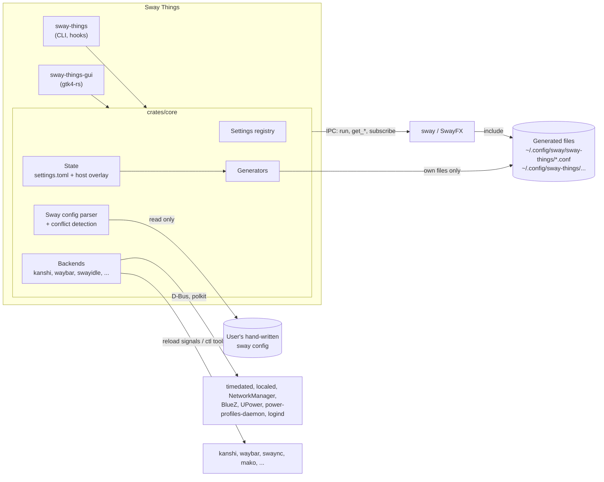

# Architecture

> The facts about sway, SwayFX and the companion tools this design relies on, with their sources, are in the
> [Sway Reference](Sway-Reference.md).

## Overview



The core idea: **apply live over IPC, persist to our own state file, generate our own include files, and only ever read
the user's files.**

## Cargo workspace

| Crate | Binary | Depends on GTK | Responsibility |
| --- | --- | --- | --- |
| `crates/core` | – | no | Settings registry, state (load, merge, save, history), generators, sway config parser, conflict detection, IPC client, backends, typed sway command builders |
| `crates/cli` | `sway-things` | no | `get` / `set` / `reset` / `open` / `doctor` / `show-generated` / `export` / `import` / `hook` |
| `crates/gui` | `sway-things-gui` | yes | GTK4 application: shell, sidebar, search, rows built from the registry, custom pages |
| `crates/cli-docs` | – (dev only) | no | Writes the man pages and shell completions in `data/` from the clap definitions of the CLI and of the app's one argument |

All crates share the package metadata and lints of the root `Cargo.toml`: edition 2024, MSRV 1.85, `unsafe_code`
forbidden, clippy pedantic, and no `unwrap`, `expect`, `panic!`, `todo!` or `dbg!` outside tests. The core also denies
`println!` and requires docs for its public API.

`crates/cli-docs` is no default member (`default-members` in the root `Cargo.toml`): a plain `cargo build` and the
distro builds compile only the three shipped crates, never `clap_mangen`, `clap_complete` or `roff`. `--workspace`
includes it, so its tests and clippy run with the others.

The CLI deliberately has no GTK dependency, so hooks that run at login or on hotplug start fast and stay small.
`sway-things` with no arguments, or `sway-things open [<link>]`, starts or activates the GUI.

## Settings registry

Every setting is **defined once** in `crates/core/src/registry/`. Everything else derives from that definition:

| Derived from the registry | From |
| --- | --- |
| GUI rows (toggle, slider, dropdown, color, entry) | the value type; auto-built for standard settings, on the setting's page |
| Search index | title, subtitle, keywords and synonyms, group title, and the sway directive; pages by title and description |
| CLI keys | the key: `sway-things set input.touchpad.tap true` |
| TOML schema and validation | the key is the path in `settings.toml`; the value type has the range or the choices |
| Defaults and "Reset to default" | the default of the value type |
| Generator output | the render function builds the commands, the mapping names the generated file |
| Conflict detection | the sway directive and block context the setting maps to; the read function gives the value of a user's line |
| Version and fork gating | `min_sway(…)`, `swayfx_only(…)` |
| Dependencies | `depends_on("effects.blur", When::On)`: the row is locked with the reason ("Turn on Blur first") while the other setting's value in effect doesn't meet the condition (on, one of some choices, above a number) |
| Scope | global / per-host / per-device / per-output (decides the host-overlay default) |
| Apply mode | live, reload, tool-reload, re-login, risky (safety net) |
| Requirements | `requires_tools(&["swayidle"])` → "Requires swayidle" indicator plus install hints |

```rust
// crates/core/src/registry/input.rs
Setting::toggle("input.touchpad.tap", Page::MouseTouchpad, false)
    .section(msg!("Touchpad"))
    .title(msg!("Tap to click"))
    .subtitle(msg!("Tap the touchpad instead of pressing it. Unless set, the device decides"))
    .keywords(&[msg!("touchpad"), msg!("trackpad")])
    .scope(Scope::PerDevice(InputType::Touchpad))
    .sway(
        Directive::input("tap"),
        ConfigFile::Input,
        |ctx| Ok(vec![ctx.input()?.tap(ctx.bool("input.touchpad.tap")?)]),
        read_switch, // sway's parse_boolean(…, true)
    )
    .build()
```

- **Value types:** boolean, integer and decimal (each with a range), choice (ids with translatable labels), color, text
  and list of texts. `Setting::check` validates a `Value` against the type. What sway accepts inside a text or a list
  depends on the directive, so the command builders check that when the setting is rendered. A list can have empty
  items, so that it lines up with another list (`["", "nodeadkeys"]`: no variant for the first layout).
- **Defaults are sway's own:** the default is what sway, libinput or SwayFX does with nothing configured (tap off, no
  gaps, `client.focused` child border `#285577`). A setting that isn't stored therefore shows what is in effect without
  Sway Things, and a reset removes the key from the state. libinput defaults that depend on the device are the common
  ones.
- **Rendering:** `Registry::render(setting, values, device, target)` returns the `SwayCmd`s for one target. The render
  function reads values through a `Context`, which checks each stored value against its setting and falls back to the
  default. Over IPC a setting can need more commands than in the config: `windows.gaps.inner` renders `gaps inner 8` for
  both, and over IPC also `gaps inner all set 8` for the workspaces that are already open.
- **Dependencies:** a setting that only matters while another one is set (blur passes while blur is on, a border width
  for the styles with a border) names it with `depends_on`. `SettingView` locks the row with `Locked::Needs` and the
  reason while the value in effect of the other setting (stored, from the user's config or the default) doesn't meet the
  condition. Stored values are still generated. The other setting is on the same page and comes earlier.
- **Order in the generated file** is the order of the registry. sway checks some directives against values already in
  effect: `titlebar_border_thickness` comes before `titlebar_padding`, so any thickness up to sway's default vertical
  padding of 4 fits before the padding changes, and the padding then fits the thickness.
- **One setting per value:** a directive with several values is several settings. The five colors of `client.focused`
  are `windows.focused.border`, `….background`, `….text`, `….indicator` and `….child_border`. Settings with the same
  directive form a group (`Registry::group`) with one render function that reads all of them, so storing one color
  writes the whole line with the defaults of the others. An `input` option is a directive of its own per input type
  (`events` of keyboards and of touchpads), so a group also shares the scope. Each member of a group names the same
  `SettingGroup` (`.group("windows.focused", "Focused window")`): an id, unique and no setting's key, and a translatable
  title the app shows the group's row with. A setting alone in its group names none.
- **Per-device settings** have `Scope::PerDevice(<input type>)`. Without a selected device they render for the type
  (`input type:touchpad tap enabled`), with one for that device's identifier.
- **Lists that line up:** layouts and variants are two settings, each with its own directive
  (`input.keyboard.xkb_layout = ["us", "de"]`, `input.keyboard.xkb_variant = ["", "nodeadkeys"]` → `xkb_layout "us,de"`,
  `xkb_variant ",nodeadkeys"`). The variants render with the number of layouts in effect: a shorter list is padded with
  empty variants, a longer one is a `RenderError::TooManyVariants`. Reading a user's `xkb_variant` splits on commas and
  keeps empty variants, except those at the end, which the padding adds again.
- **Empty means sway's default:** where XKB takes an empty value as none or as its default, the setting's default is
  empty and renders as `""`: no variants (`xkb_variant ""`), no XKB options (`xkb_options ""`, which also overrides
  `XKB_DEFAULT_OPTIONS`) and the default model (`xkb_model ""`, pc105). Like every setting, they are only written when
  stored.
- **Directive:** each sway setting names its directive, the block it stands in (top level or `input`) and, where one
  name covers independent values, the leading arguments (`gaps` + `inner`, `for_window` + `[all]` + `inhibit_idle`). A
  value can render no line at all: idle inhibition that is off leaves the user's own `inhibit_idle` rules alone.
- **Reading:** each sway setting also has a read function, the reverse of rendering: `Setting::read` takes a directive
  of the user's config and returns the value sway reads from it. The helpers follow sway's own parsing: its words for
  true (`parse_boolean`, everything else is false), `strtol` and `atoi` for numbers, `parse_color` with or without `#`
  (an opaque alpha is the same color as none), the defaults of a `client.*` line for the colors it leaves out (the
  indicator of the class, the background as child border). A line sway refuses (`ReadError::Rejected`) is told apart
  from a value sway takes but the setting can't hold (`ReadError::Unsupported`, e.g. out of its range). Every setting of
  a group reads its own value from the same line.
- **Apply mode:** live by default. A setting built on a config-only command (`workspace_layout`, `xkb_numlock`,
  `xkb_capslock`) must use reload. Settings that change what the keys produce (layouts, variants, XKB options) are
  risky. Instead of the safety net, a range keeps other settings usable: the repeat rate is at least 1 per second (sway
  turns repeating off at 0) and the repeat delay at least 100 ms (below that every key repeats almost at once).
- **Preferences of Sway Things itself** (`app.safety_net_timeout`, `app.accent_source`, `app.editor_command`,
  `app.show_directives`, `app.remember_collapsed_sections`) are settings without a sway mapping. A text setting can have
  its own check beyond the type (`SettingBuilder::check_text`; the editor command must split into words) and a hint for
  its empty field (`SettingBuilder::placeholder`).
- **Search:** `SearchIndex::new(registry, translate)` collects the texts of every page and setting once, in English and
  translated, in lowercase. Synonyms are keywords like any other (`dpi`, `sensitivity` → _Pointer speed_), and so is the
  title of a setting's group (_Focused window_ for its _Title bar border_). `search` needs every word of the query in
  one of the texts, case-insensitively. Hits where every word starts a word come before hits inside words (`tap` in _Tap
  to click_ before _metaphor_), then they rank by the weakest field a word was found in: title, keyword, subtitle (a
  page's description), directive. Each hit is a `Link` to its page and setting, so opening one works like a deep link.
  Pages are found by name whether they have settings or not.
- **Pages:** `Page::ALL` lists every page of the app in sidebar order, each with its id, sidebar group (`Group`), title
  and one-line description. The id is what deep links and the CLI use (`sway-things open mouse-touchpad`). Every setting
  names its page, and the registry lists the settings in page order.
- **Deep links:** `Link::parse` reads a link as a page id (`keyboard`) or the key of a setting
  (`input.keyboard.repeat_rate`), which opens the setting's page at its row; keys contain dots, page ids don't. An
  unknown page is a `LinkError` that lists the page ids, an unknown key one that lists the keys it comes closest to
  (those that start with the longest known part, `input.keyboard.`). The CLI and the app read links the same way.
- **Sections:** every setting names the section of its page it is shown in (`.section("Touchpad")`, translatable), and
  the settings of a section are next to each other.
- **Sliders:** a number setting can give a slider range and step narrower than what sway accepts
  (`.slider(100.0, 2000.0, 10.0)` for a repeat delay sway takes up to 65535 ms). Without one, the slider covers the
  whole range, in steps of 1 for whole numbers and a hundredth of the range for decimals.
- **Config line:** `Registry::config_line(setting, values, device)` is the line of the generated file for a value, as
  the app shows it under the title: an `input` option without its `input <selector>` (`pointer_accel 0.3`).
- **What a row shows** (`crates/core/src/view.rs`): `SettingView::of(setting, device, state, status, compositor)` gives
  the value in effect and its source: the stored value (for a device without one of its own, its type's), else what the
  user's config sets (the last line that decides it, with file and line), else sway's default. With one value of a group
  stored, Sway Things writes the whole line, so the others show its defaults. It also has the config line and why the
  setting is locked: no include line, or a compositor that doesn't support it.

Tests check the invariants over every entry: keys are unique and valid TOML paths, defaults fit their type, every
setting renders for the config and every live one for IPC, at the limits of its range and for every choice, config-only
commands force the reload mode, and the declared requirements equal those of the commands built for the default (a value
may need more, like sticky drag lock on sway 1.11; SwayFX settings go to `90-effects.conf`, nothing else does). The
settings that name a `SettingGroup` are exactly those that render one directive together, next to each other on one page
and in one section.

Pages that don't fit the row model are hand-written GTK widgets: the Displays canvas, the bindings editor, the bar
layout editor and the window preview. They still read and write settings through the registry.

## State

```text
$XDG_CONFIG_HOME/sway-things/
├── settings.toml          # shared values: commit to dotfiles
└── settings.d/
    └── <hostname>.toml    # per-machine overrides (optional)

$XDG_STATE_HOME/sway-things/
├── manifest.toml          # every file we generated, with hash, for "changed outside Sway Things" detection
├── ui.toml                # which sections of which pages are collapsed (app state, not a setting)
└── history/               # snapshots of the settings files (restore, undo)
    └── 20261110T142355Z/  # both files as they were before a save, named after the UTC time
        ├── settings.toml
        └── settings.d/<hostname>.toml
```

```toml
# settings.toml
version = 1

[input.touchpad]
tap = true

[windows.focused]
child_border = "#3b6e4f"

# settings.d/laptop.toml
version = 1

[device."1267:12377:ELAN1300:00_04F3:3059_Touchpad".input.touchpad]
tap = false
```

- **Sparse:** only settings the user changed are stored. A missing key means _not managed by Sway Things_: the user's
  own config or the sway default applies. A reset removes the key (and tables that are empty afterwards).
- **Keys are TOML paths:** the registry key `input.touchpad.tap` is `tap` in the table `[input.touchpad]`. Colors are
  strings (`#rrggbb`, `#rrggbbaa`), choices are their id, lists are arrays of strings, and a decimal setting also takes
  a whole number.
- **Host overlay:** `settings.d/<hostname>.toml` overrides `settings.toml` key by key. The host name is the kernel's
  (`uname -n`). New values go to the shared file, except those bound to this machine's hardware (a value for one device,
  per-host and per-output settings), which go to the overlay. A changed value stays in the file it is in. The UI shows a
  "this machine only" toggle per setting, which moves the value between the two files. A value written to the shared
  file removes the one in the overlay, which would hide it otherwise.
- **Per-device values** are stored below `device."<identifier>"` (the identifier from `GET_INPUTS`) at the same key as
  the value for all devices of the type. A device without a value of its own uses the value of its type.
- **Hand edits allowed:** a file watcher reports when either file may have changed, and the state reloads the files
  whose content differs from what it last loaded or wrote. So its own saves cause no reload. A reload returns the
  settings whose value in effect changed, for the GUI and the generators. The file on disk wins: a change to that file
  that wasn't saved yet is dropped and is among the changed settings. Whatever doesn't fit the registry is reported with
  file and key, never silently dropped, and the rest still loads: unknown keys, values of the wrong type or out of
  range, entries of `device` that aren't device identifiers, and settings in a device table that can't be set per
  device. The lines stay in the file. A save only changes the lines of the settings that changed; comments, order,
  formatting and unknown keys survive.
- **Schema version:** a top-level `version = 1` key, for migrations. A file without it loads as version 1, and the first
  save adds the line. A file with another version, a syntax error or one that can't be read is reported and left alone:
  nothing in it is in effect, and it is never written. The other file keeps working.
- **Saving needs the include line:** `State::save` takes the write permission that only an active
  [include status](#include-detection) hands out. Loading, changing values in memory and reading need none.
- **Atomic saves:** a changed file is written to a temporary file next to it and renamed over it. If the file is a
  symbolic link (into a dotfiles repository), the link stays and its target is replaced. File access is synchronous
  (`std::fs`): the files are small, and only loading and saving touch the disk.
- **App preferences** (accent source, safety-net timeout, editor command, …) live under `[app]` and are ordinary
  registry entries.
- **Export / import:** `settings.toml` (plus overlays) _is_ the export format.
- **History:** before a save replaces anything, both files as they are on disk go to `history/` as one snapshot, also if
  they were changed outside in the meantime. A snapshot equal to the newest one is skipped, and the newest 50 are kept.
  If the snapshot can't be written, nothing is replaced. Restoring a snapshot loads both files from it, comments and
  unknown keys included (a file that didn't exist then becomes empty), and is written by a normal save, which takes a
  snapshot in turn, so a restore can be undone. A snapshot of a file that can't be loaded can't be restored.
- **Backups:** we never write user files, so we never need to back them up. `history/` covers our own state.
- **Window state:** `ui.toml` lists the collapsed sections by page id and section id (the English section title in
  lowercase words joined by dashes, `focused-tab-title`), version 1. It is UI state, not a setting, so it lives per
  machine next to the history and never in `settings.toml` or the host overlay, and dotfiles diffs stay clean. The app
  writes it atomically on each collapse or expand while `app.remember_collapsed_sections` is on, also while read-only; a
  missing or broken file means every section is expanded, and unknown page or section ids are ignored
  (`ui_state::UiState`).

### File watcher

`crates/core/src/watch.rs` watches a set of files for any part of the app: the settings files, and the sway config files
for the [include detection](#include-detection).

- It uses the `notify` crate (inotify on Linux, kqueue on the BSDs) and watches **directories**, not files: the
  directory of each file, or the nearest one above it that exists. That covers a file that is created later, deleted, or
  replaced by a rename (how editors and `git` save), and a directory that appears or goes away. For a file that is a
  symbolic link, the directory of its target is watched too.
- Events about other files in those directories and reads are ignored.
- It can also watch a **directory** for the files directly in it (created, changed, renamed, deleted), which is how a
  glob such as `include config.d/*` is followed.
- **Debounce:** a burst of events becomes one report once the watched files have been quiet for 200 ms (after 2 s at the
  latest), so a reader doesn't see a half-written file.
- A report only says that a file _may_ have changed; the reader decides. That keeps self-write suppression out of the
  watcher.
- The watcher debounces on its own thread and hands reports over through a channel. It needs no particular executor:
  await the next report on the glib main loop, or block on it in the CLI.

## Generated files and the file rule

**Rule: Sway Things only writes files it created**. A file we created carries a header and is recorded in
`manifest.toml`. If its hash no longer matches, someone edited it. The app shows a warning and asks before overwriting.

### sway

```text
$XDG_CONFIG_HOME/sway/sway-things/
├── 10-input.conf
├── 20-output.conf         # only when kanshi is not the display backend
├── 30-appearance.conf
├── 40-behavior.conf
├── 50-bindings.conf
├── 60-idle.conf           # swayidle exec line, if the user handed idle over
├── 70-autostart.conf
├── 80-hooks.conf          # bindswitch lid → sway-things hook lid …
└── 90-effects.conf        # SwayFX only; comments instead of directives on vanilla sway
```

```text
# Generated by Sway Things from ~/.config/sway-things/settings.toml. DO NOT EDIT.
# Change settings in the app or with `sway-things set`. Hand edits are overwritten.
input type:touchpad tap enabled
input type:touchpad pointer_accel 0.3
input "1267:12377:ELAN1300:00_04F3:3059_Touchpad" tap disabled
```

`crates/core/src/generate/` makes these files. v0.1 has `10-input.conf`, `30-appearance.conf`, `40-behavior.conf` and
`90-effects.conf`.

- **Content:** `generate` turns the stored settings into file contents without writing anything, which is also what
  "Show generated config" and `sway-things show-generated` display; `on_disk` reads the files as they are, with their
  ownership (absent, current, ours, edited outside, foreign), for the window to mark. Below the header, each line is one
  command exactly as the command builders render it for a config file; there are no blocks. The settings of one
  directive make one line. The order is the order of the registry, the lines for input types before those for single
  devices, so the same state gives the same bytes. The registry decides the file of each setting.
- **Unsupported settings:** a stored setting the compositor doesn't support becomes a comment instead of a command, e.g.
  `# effects.corner_radius: requires SwayFX 0.5 or newer`, so the file stays valid and says why a setting has no effect.
  The same happens to a value the command builders reject. The value stays stored. The compositor is the running one,
  asked over IPC; without a session it is the installed one, read from `sway --version`.
- **Validation:** a file whose content changed is staged next to its place, under a hidden name that `*.conf` doesn't
  match, and checked with `sway --validate --config <staged file>` as a main config of its own. sway runs through
  `async-process` with an argument array. Only a valid file replaces the old one, atomically; a symbolic link stays one.
  If sway rejects the file, the old one stays, and each error carries the line and the settings behind it. If sway can't
  be run, nothing is replaced.
- **Manifest:** `manifest.toml` records the SHA-256 hash of each generated file by absolute path (the value `sha256sum`
  prints). Before a file is replaced, its content is compared:

  | The file on disk… | Result |
  | --- | --- |
  | doesn't exist | created, unless it would hold only the header |
  | already holds the new content | left as it is, and recorded |
  | has the recorded hash | replaced |
  | is recorded with another hash, or isn't recorded but starts with the header | reported as changed outside; replaced only after the user agreed |
  | isn't recorded and doesn't start with the header | never written |

  A generated file that isn't recorded came with the dotfiles from another machine, or the manifest was lost; that is
  why the header counts. A manifest that is missing or broken is empty.
- A file that loses its last setting keeps existing with only the header.
- **Writing needs the include line:** like saving the state, `generate::write` takes the write permission of an active
  [include status](#include-detection). `generate` needs none, so the preview works while read-only.

The user adds **one line** to their own config, normally as the last line:

```text
include ~/.config/sway/sway-things/*.conf
```

The app never adds this line itself. It shows the line with a copy button and detects it via the parser, see
[Include detection](#include-detection).

### Other tools

| Tool | Include support | Strategy |
| --- | --- | --- |
| kanshi | yes (`include`, wordexp) | Our file `~/.config/kanshi/sway-things.conf`; the user adds `include` to their kanshi config. With no kanshi config at all, we create `~/.config/kanshi/config` ourselves |
| waybar | `include` exists, but **the first definition wins**, so included files can only add, never override | **Handover:** our complete config + CSS in `~/.config/sway-things/waybar/`; the user starts waybar with `-c`/`-s` (instructions), or we create `~/.config/waybar/config.jsonc` if none exists. "Import as starting point" reads their file into our state |
| swaylock | no | Our config `~/.config/sway-things/swaylock/config`; our generated swayidle line calls `swaylock -C <path>` |
| swayidle | n/a (started via `exec`) | Our generated `60-idle.conf` holds the `exec swayidle …` line. If the user's config already starts swayidle, the page shows "managed externally" plus a handover explanation |
| mako | yes (`include=`, absolute or `~/` path; later definitions win) | Our file `~/.config/mako/sway-things`; the user adds `include=` at the end of their mako config. With no mako config at all, we create it |
| swaync | no, but `-c` / `-s` flags | Handover: our `config.json` + `style.css` in `~/.config/sway-things/swaync/`; the user starts swaync with `-c`/`-s` |
| gammastep / wlsunset | gammastep has a config file; wlsunset uses arguments | Own config file or our generated `exec` line |
| environment | `environment.d` is a directory | Our own file `~/.config/environment.d/50-sway-things.conf` |
| default apps | XDG spec: desktop-specific list | Our own `~/.config/sway-mimeapps.list`, read before `mimeapps.list` under `XDG_CURRENT_DESKTOP=sway`; the user's `mimeapps.list` is never touched |
| GTK look, fonts, dark mode | dconf database | Written via gsettings/GIO (official API, allowed) |
| electron/chromium flags | text files | Create if missing, otherwise handover |
| XDG autostart | directory of `.desktop` files | Our entries are `exec` lines in `70-autostart.conf`. To disable a system entry we create **our own** override `~/.config/autostart/<name>.desktop` with `Hidden=true` (only if no user file of that name exists). The runner (`xdg-desktop-autostart.target` or `dex -a`) is started from our include |

**Handover** means we generate our own complete file and the user switches the tool to it once (an instruction with a
copy button). Alternatively the user deletes or renames their own file, and we create the standard one.

## Data flow

### Changing a normal setting

1. The user flips a toggle (or runs `sway-things set …`).
2. The core builds the sway command with the [**typed builder**](#sway-command-builders) and sends it over IPC
   (`RUN_COMMAND`) → instant effect.
3. The core updates the in-memory state and saves `settings.toml` / the overlay after a debounce (~500 ms).
4. The generators regenerate the affected files:
   - write to a staged file → `sway --validate --config <staged file>` for each staged file → atomic replace. Each file
     is validated as a main config of its own: sway ignores errors in included files (`cmd_include` in sway 1.10 –
     1.12), and `--validate` only reports the main file, so a wrapper config that includes the staged files would always
     pass. This works without a running session (checked with sway 1.12); errors are reported per line, so they can be
     mapped back to settings;
   - update the hash in `manifest.toml`.
5. Conflict detection re-runs for that setting and updates the indicators.

`crates/core/src/apply/` is this flow for the CLI and the GUI alike. An `Applier` owns the state and the IPC connection.

- **`set` and `reset`** check the change against the registry, send the commands and change the state in memory. Both
  need the write permission of an active [include status](#include-detection).
- **A failed command changes nothing:** the state is as before, and commands of the same directive that were already
  sent are undone with the previous values.
- **Reset** removes the stored value and sends sway's default (for one device: the value of its type). A value the
  user's own config sets is back after the next reload of sway. A reset of a setting that isn't stored sends nothing.
- **Refused:** risky settings (they change and reset only through the [safety net](#risky-settings-safety-net)), and a
  `set` of a setting or value the compositor doesn't support, with what it needs. Nothing is stored then. A reset is
  always allowed, so such a value can be removed.
- **Without a session** (the CLI at login) the change is only stored, saved and generated, for the compositor the
  installed `sway` reports. The result says so.
- **`persist`** saves the settings files, generates every file and writes those that changed. The result has the outcome
  per file, so the caller can show sway's errors with the settings behind them and ask before it overwrites a file that
  was changed outside. The CLI calls it right after the change. The GUI asks the applier when saving is due, 500 ms
  after the last change, and waits for that with a timer of its main loop.
- **Changes on disk:** when the watcher reports the settings files, `reload` loads them, sends the changed settings
  (those of one directive once) and leaves the rest to `persist`. The file wins, so a command that fails undoes nothing
  and is reported. Risky settings aren't sent; they are in effect after the next reload of sway.
- The result of each step says how the change takes effect: live with the commands sent, without a session, after a
  reload of sway (`command::reload`, which the caller runs when it suits), after a tool reload or a re-login.
- **Waiting changes:** in a session, the applier notes each change that waits for a reload of sway or a re-login
  (`waiting`), with the stored value from before, which is what sway still runs with. A change set back to that value no
  longer waits. Risky values from changes on disk aren't noted: a reload would apply them without the safety net.
- **`reload_sway`** persists, then sends `reload`. It refuses while a risky change waits (the reload would put the
  stored value back), without a session, and when a generated file with a waiting change couldn't be written. Afterwards
  the changes that waited for a reload are in effect; those for a re-login still wait. `reloaded` notes a reload from
  elsewhere, which sway reports as a `workspace` event with the change `reload` (`ipc::Reloads`); it only counts for
  changes that were in the generated files by then.

### Risky settings (safety net)

Display mode, disabling an output or input device, changes of the keyboard layouts, variants and XKB options:

1. Snapshot the current value and apply live.
2. Show the _Keep / Revert_ banner with a 15 s countdown.
3. **Nothing is persisted until the user presses _Keep_.** Revert or timeout re-applies the snapshot over IPC.
4. Lockout protection: the last enabled keyboard and the last enabled pointing device can't be switched off (outputs
   come with the Displays page).

`crates/core/src/apply/risky.rs` is this flow in the core; the GUI banner and the CLI prompt build on it.

- **`Applier::try_risky`** checks the change like `set` does, sends it and returns a `Countdown` with the deadline from
  `app.safety_net_timeout` (15 s by default). Nothing is stored. The snapshot is the value in effect as a row shows it
  (`SettingView`): the stored value, else what the user's config sets, else sway's default. sway reports keyboard
  layouts only by their names (`English (US)`), not as `xkb_layout` takes them, so the core's value is what is restored.
- **`Applier::try_risky_reset`** tries removing the stored value the same way. It sends the value that is in effect
  without it, as a row would show it then: what the user's config sets, else sway's default (for one device: the value
  of its type). That is the value sway has after the next reload, so that is what the safety net tests. A setting
  without a stored value sends nothing.
- **`Applier::try_risky_all`** tries several settings of one device as one change, kept or reverted as a whole: the
  Keyboard page adds, removes and reorders a layout together with its variant, and resets both together. Each setting
  gets a new value or is removed as in `try_risky_reset`. The directives are sent in registry order. A setting can name
  another that is sent at its default first when both are in the change (`clears_first`: the layouts clear the
  variants), so no command in between pairs a layout with a variant it doesn't have; the revert does the same.
- **`keep`** stores the value like any other change, or for a reset removes it (saved with `persist`); nothing more is
  sent. **`revert`** sends the snapshot; the caller runs it when the user says so and when `Countdown::elapsed` returns.
  The countdown waits with `async_io`, so it works under the GTK main loop and `block_on` alike.
- **One at a time:** while a change waits, another risky change is refused until it is kept or reverted.
- **Only in a session:** without a running sway nothing can be tried and reverted, so `try_risky` refuses.
  `set_risky_unchecked` and `reset_risky_unchecked` (for `sway-things set --yes` and `reset --yes`) send the value if
  there is a session and store or remove it at once.
- **Lockout protection:** a change of `events` asks sway for the devices and is refused if it would leave no usable
  keyboard or pointing device ([Input devices](#input-devices)), for one device as for a whole type. A session that has
  none to begin with (a headless sway) has nothing to lose. Without a session the devices aren't known, so switching off
  a whole type of keyboards or pointing devices is refused, one device is allowed.
- **If the app or the command line ends** while a change waits, nothing was stored: the session keeps the tried value
  until the next reload of sway (or login), which brings back the old one.

**In the app** (`crates/gui/src/model.rs`, `window.rs`): a change of a risky row goes through `try_risky` instead of
`set`, and the model keeps the `Pending` change for the rows (they show its value) and the window (the banner). A glib
timer at the countdown's deadline queues the revert; _Keep_ and _Revert_ queue `keep` and `revert`. Refusals reach the
row through the `failed` signal. Closing the window while a change waits reverts it, then closes.

**From the CLI**: in an interactive terminal, `sway-things set` and `reset` apply live, ask `Keep? [y/N]` with the same
countdown, and save only on `y`. Without a TTY it refuses unless `--yes` is given, so scripts and hooks never hang.

### Apply modes

| Mode | Example | Mechanism |
| --- | --- | --- |
| live | gaps, colors, input options | IPC command + persist |
| reload | settings sway only honors at load | persist + `reload` after the user confirmed (reload banner) |
| tool reload | kanshi, waybar, swaync | `kanshictl reload`, `SIGUSR2` to waybar, `swaync-client -R`, … |
| re-login | environment.d, `xwayland` (sway reads it only at startup) | persist + "takes effect after re-login" badge |
| risky | see above | live + safety net, persist on _Keep_ |

## Sway command builders

Every sway command, sent over IPC or written into a generated file, is a `SwayCmd` from `crates/core/src/command/`. A
command is a list of typed parts: keywords (static strings from our code, only ASCII letters, digits and `_ . : * + -`),
integers, finite decimals, booleans in the directive's spelling (`enabled`, `yes`, `on`, …), colors (`#rrggbb`,
`#rrggbbaa`), text and criteria. External strings only enter as `SwayText` or as criteria values, never as a raw string.

sway parses IPC commands and config lines differently (`execute_command` and `config_command` in `sway/commands.c`,
helpers in `common/stringop.c`; unchanged from 1.10 to 1.12):

| | IPC (`RUN_COMMAND`) | Config line |
| --- | --- | --- |
| Command separators | `;` and `,` outside quotes | none, one command per line |
| `$variables` | replaced in each argument, after unquoting | replaced in the whole line, before unquoting |
| Quotes | stripped from arguments that start with one (not for `exec`, `mode`) | the same (also not for `bindsym`, `set`, `for_window`, …) |
| Backslashes | kept, but still escape the next quote | unescaped (`\"`, `\\`, `\n`, …) |

So `SwayCmd::render` has two targets:

- **Text over IPC:** quoted with `"`, or with `'` around a run that contains `"`; every `$` is doubled.
  `Dell "U2415" $1` becomes `'Dell "U2415" $$1'`.
- **Text in a config line:** quoted with `"`, inner `"` become `\"`, every `$` is doubled: `"Dell \"U2415\" $$1"`.
- **What text can't contain:** `SwayText` rejects empty text, control characters (they end a config line or change how
  sway splits it) and backslashes. An empty value is a part of its own, `SwayCmd::empty_text`, rendered `""` in both
  targets, which sway unquotes to an empty argument; only builders whose directive gives the empty value a meaning use
  it (`xkb_variant`, `xkb_options`, `xkb_model`). sway's IPC splitter keeps its escape flag across `\'` and then
  misreads the next quote, so a backslash next to a quote can't be represented reliably.
- **Criteria** match exactly. Each value becomes an anchored PCRE2 regex `^…\z` in which every character except ASCII
  letters, digits and `_` is written as `\x{hex}`, so criteria never contain a quote, `$`, `]` or whitespace. Config
  lines double the backslashes, because sway unescapes them.
- **`for_window`:** sway stores the inner command and parses it again, like an IPC command, when a window appears. So
  its text is quoted twice over IPC, and its `$` doubled twice in a config line. The inner command can't contain
  criteria or another `for_window`.
- **Leading criteria:** `SwayCmd::with_criteria` builds `[app_id="…"] opacity 0.8`, which applies a command to open
  windows. It only works over IPC, and sway reports a failure if no window matches. Per-app settings use it for the live
  change and `for_window` for windows that open later.
- **Availability:** some commands work only in config files (`xwayland`, `xkb_numlock`, `workspace_layout`,
  `default_orientation`), so settings built on them apply with a reload instead of live. Others work only over IPC.
  While sway reads the config it defers commands such as `xkb_switch_layout`, `focus` and `workspace <name>` and later
  runs them through the IPC parser, so their builders are runtime-only. Rendering for the wrong target is an error.
- **Minimum version:** a command records the oldest sway that understands it (`SwayCmd::min_sway`, by default sway
  1.10), and for SwayFX directives the oldest SwayFX (`SwayCmd::min_swayfx`, `None` if vanilla sway understands it).
  Rendering doesn't check either; the registry compares them with the running compositor (SwayFX by its base sway
  version for `min_sway`).

On top of `SwayCmd`, typed builders cover the directives of each page, with an enum per set of values and range checks
on numbers taken from sway's and SwayFX's own checks:

- `command::input` builds `input <identifier> …` for every device (`*`), a device type (`type:touchpad`) or one device
  by its `GET_INPUTS` identifier. `drag_lock enabled_sticky` needs sway 1.11, and a sway built against a libinput that
  supports it; otherwise sway reads it as `disabled` without an error. The XKB lists are joined with commas, so an item
  can't contain one; `xkb_layout` needs at least one layout, the variants, options and model can be empty.
- `command::window` builds colors (`client.*`; sway ignores `client.background` and `client.placeholder`, so they have
  no builder), borders, gaps, the title bar and `opacity`. `gaps <which> <px>` only changes the default for new
  workspaces, and `gaps <which> all|current set <px>` (runtime-only) only open workspaces, including those with gaps of
  their own from `workspace <name> gaps`; the registry combines them. sway rejects a title bar padding below the border
  thickness and a thickness above the vertical padding, so the order of those two commands matters.
- `command::effects` builds the SwayFX effects with the names and ranges of SwayFX 0.5; `animation_duration_ms` needs
  SwayFX 0.6. `corner_radius` raises the horizontal title bar padding to at least the radius.
- `command::behavior` builds focus, layout, floating, dragging, popup, Xwayland and idle inhibition settings.
  `floating_minimum_size` and `floating_maximum_size` take each dimension as no limit (`-1`), sway's automatic value
  (`0`) or pixels. `inhibit_idle`, like `opacity`, is wrapped in `for_window` or leading criteria for per-app rules.

A port of sway's parsing functions (`command/model.rs`, tests only) checks with property tests that every accepted value
arrives unchanged in both targets. Fixture files generated from the builders (`ci/integration/*.conf` and `*-ipc.txt`)
go to real sway 1.10, sway latest and SwayFX: every generated config file must pass `sway --validate` on its own, every
IPC command must succeed, and the escaping fixtures read every value back. Fixtures marked `# Needs SwayFX.` only run on
SwayFX.

## Reading the current state

- **IPC:** `GET_VERSION`, `GET_INPUTS`, `GET_OUTPUTS`, `GET_SEATS`, `GET_BINDING_MODES`, `GET_BINDING_STATE`,
  `GET_TREE`, `GET_CONFIG`. Event subscriptions for `input`, `output`, `mode`, `workspace`, `shutdown`, `tick`, so
  hotplugged devices and outputs appear immediately. See [IPC client](#ipc-client).
- **`GET_CONFIG` only returns the main config text**, not included files. Many values (all `client.*` colors, `gaps`,
  `font`, bindings) aren't exposed over IPC at all. So the core has its own **read-only parser**.

### IPC client

`crates/core/src/ipc/` talks to the compositor over the socket in `$SWAYSOCK` (`man 7 sway-ipc`).

- **Transport:** the wire format (the magic string `i3-ipc`, payload length, message type, JSON payload) is implemented
  in the core on async-io's Unix socket, so the client runs on any executor. Replies and events are read into the types
  of the `swayipc-types` crate (`ipc::types`). Those types are strict: a value they don't know makes that reply an
  error, not a guess.
- **Without a session:** an unset `SWAYSOCK` ("not in a sway session") and a socket nobody answers on ("sway is not
  running") are different errors, so the CLI and the read-only parts can say which it is and carry on.
- **Compositor detection:** connecting sends `GET_VERSION`. SwayFX is the compositor that sends `sway_original_version`,
  the sway it is based on; its own version is in the version numbers then. A compositor below sway 1.10 or SwayFX 0.5 is
  refused, with what was detected in the error.
- **Commands:** `Client::run` takes a `SwayCmd`, renders it for IPC and sends it in a `RUN_COMMAND` message of its own,
  so the result belongs to that command. A rejected command returns sway's error message and whether it was a parse
  error. A command that needs a newer sway or SwayFX than the running one isn't sent at all: sway doesn't reject every
  value it doesn't know (`drag_lock enabled_sticky` on sway 1.10 means `disabled`).
- **Events:** `Client::subscribe` opens a second connection, so replies and events don't mix, and `Events::next` returns
  them in order. An event that can't be read is an error for that event only, an unknown event type is skipped, and the
  events end when sway closes the connection (after a `shutdown` event, if subscribed).
- **Connecting under load:** sway queues only a few connections before it accepts them, and a connect while that queue
  is full ends unconnected. The client checks the connection and tries again for up to two seconds.
- After an I/O or protocol error a connection is out of step and has to be replaced.

### Input devices

`crates/core/src/devices/` is the list of input devices for the device selectors of the pages, per-device settings and
the lockout protection.

- **From sway:** each device has the identifier sway selects it by, the name to show, the type (`keyboard`, `pointer`,
  `touchpad`, …; a type this build doesn't know is listed without one), whether it is switched off (libinput's
  `send_events`), and for keyboards the layouts and the one in use. The name is an external string: it is shown and
  never part of a command.
- **Hotplug without polling:** `DeviceWatch` subscribes to sway's `input` events on a connection of its own and reads
  `GET_INPUTS` again after each one. It reports what changed (added, removed, changed) and skips events that changed
  nothing. Devices of the same model share an identifier, and with it every setting, so they are one entry that stays
  until the last of them is unplugged; an event alone doesn't say which one went.
- **Stored but not connected:** a device with values in the settings files stays listed as disconnected, with the type
  its settings are for and the name part of its identifier, so its values can still be seen and removed.
- **Last keyboard, last pointing device:** the list says whether switching a device off would leave no keyboard or no
  pointing device (mouse, trackpoint or touchpad). Only connected devices that aren't switched off count, and only those
  with a vendor ID: sway lists the power button and the video bus (`0:1:Power_Button`, `0:6:Video_Bus`) as keyboards,
  and virtual devices of other programs have vendor 0 too. The extra keys some mice register as a keyboard can't be told
  apart and count. A touchpad that is off while an external mouse is connected counts, because it works again once the
  mouse is gone. `Devices::lockout(type, device, sending)` says what switching the devices of a type (or one of them) to
  a sending mode would leave the user without.
- **Switching the layout:** `devices::switch_layout(client, keyboard, switch)` switches the active layout of every
  keyboard, or of the keyboards a selector picks (one by its identifier), to the next, the previous or the one at an
  index (`xkb_switch_layout` over IPC). It is an action, not a setting: nothing is stored, and sway starts with the
  first layout again.

### XKB rules

`crates/core/src/xkb/` lists the keyboard models, layouts, variants and XKB options of the system for the Keyboard page,
from the rules registry of xkeyboard-config. It only reads.

- **Which files:** `rules/evdev.xml` in the XKB config root (`$XKB_CONFIG_ROOT`, otherwise `/usr/share/X11/xkb`); sway
  uses the `evdev` rules. `rules/evdev.extras.xml` is merged in if it exists: its layouts, its variants of layouts the
  base file has and its options of known groups are added, each marked as extra, like the entries the registry marks as
  exotic. Pages show extra entries only on request.
- **What is kept:** for each entry its name and English description, and where the registry has them the short
  description, the vendor of a model, and the languages (ISO 639) and countries (ISO 3166) of a layout or variant, so
  search can match them. Option groups know whether more than one of their options can be set. Lookups give the entry
  for a model, layout, variant or option name, and the options of a group (`grp` for the layout switching shortcut).
- **Errors:** a missing or broken base file is reported and leaves the lists empty; the pages still take names typed by
  hand. A missing extras file is normal; a broken one is reported and the base file's entries stay.
- **External input:** each file is read up to 4 MiB (the registry has about 250 KiB) and at most a million XML nodes. A
  file that declares entities is refused; the DTD the registry names is never loaded, so nothing is fetched or run.
  Unknown elements, translated descriptions (`xml:lang`) and entries without a name are skipped, and a name that turns
  up twice keeps its first entry. Property tests feed the parser arbitrary bytes.
- **Translations** of the descriptions (the `xkeyboard-config` gettext domain) are not read yet.

### Sway config parser

`crates/core/src/sway_config/` reads the user's config the way sway's `read_config` does, and only reads.

- **Which file:** `parse` takes the path of the main config. In a session, `GET_VERSION` names the loaded one; otherwise
  `default_path` follows sway's search order: `~/.sway/config`, `$XDG_CONFIG_HOME/sway/config`, `~/.i3/config`,
  `$XDG_CONFIG_HOME/i3/config`, `/etc/sway/config`, `/etc/i3/config`.
- **Lines:** a line starting with `#` is a comment (there are no comments at the end of a line), a backslash at the end
  joins the next line, and a `{` on a line of its own belongs to the line before it.
- **Blocks:** like sway, the parser puts the line that opened a block in front of every line inside it. A directive
  carries its block as words: `["input", "type:touchpad"]`, `["bar", "colors"]`, `["mode", "resize"]`. `input`, `output`
  and `seat` settings written on one line (`input type:touchpad tap enabled`) get the same block, so both spellings read
  the same. Blocks nest at most 32 deep (each line repeats every line that opened its blocks, so deeper nesting would
  take quadratic time); a deeper block is skipped up to its `}` with everything in it.
- **Variables:** `set $var` is applied **when each line is read** (see `config_command` in sway's `commands.c`), so a
  later `set` doesn't change earlier lines. Longer names are tried first, `$$` is a literal `$`, and the command itself
  can come from a variable. Variables carry over into included files.
- **Arguments** are what the command gets: variables replaced, quotes removed and escapes resolved. `exec`,
  `exec_always`, `bindsym`, `bindcode`, `bindswitch`, `bindgesture`, `mode`, `set` and `for_window` keep their quotes,
  as in sway.
- **Includes** are read in place, relative to the directory of the including file, each file at most once (which also
  ends cycles). sway expands the path with `wordexp`; the parser does the same itself: words split at blanks, quotes
  removed, `~` and `$VAR` / `${VAR}` replaced from the environment, globs matched with the rules of `glob(3)` (sorted,
  no hidden files unless the pattern starts with a dot, a pattern that matches nothing stands for itself).
- **Never executes anything.** An include with `$(…)` or backticks, `~user`, a `${VAR…}` operator or something `wordexp`
  rejects is reported as an unresolved include; what such a file would set is unknown.
- **Output:** the directives in the order sway runs them, each with file, first line, block, command, resolved arguments
  and the text as written; every `include` with the paths it stood for and the files read because of it; and diagnostics
  (unreadable file, not a regular file, unresolved include, include not found, file already included, unbalanced braces,
  blocks or includes nested too deeply, a config too big to read). Only a config too big to read stops the parser; it
  reads on after the others.
- **Best-effort by design:** the parser doesn't know which commands exist or what they do; that is for conflict
  detection and the registry. It reads through a `Files` trait, with the real file system or files in memory.
- **Robustness:** the work is bounded by limits on what the config expands to, not only on its size, because short lines
  can stand for long text: include depth (32), block depth (32), directives (100,000), file size (8 MiB, for the main
  config and every included file; a file is read no further than that, so a file that never ends can't fill the memory),
  a line once its variables are replaced (8 MiB; a variable holds a line, so lines that each use it twice would double
  it every time), and the text of all lines with their block prefixes and variables replaced plus the paths of their
  includes (64 MiB; otherwise each line could copy a long variable or block line). Too many directives, a line too long
  or too much text end the config; a file too big and includes or blocks too deep are skipped; each with a diagnostic.
  Every step within these limits is linear in the length of its input. Property tests feed the parser arbitrary bytes
  and compare its line splitting with the port of sway's parser that the command builders are tested against. A
  cargo-fuzz target feeds it configs with their includes in memory and checks that it ends within its limits without a
  panic (see [Testing](#testing)).
- **Only regular files:** the main config and every included file are read only if they are regular files once symbolic
  links are followed (sway follows them too). A directory, device (`/dev/zero`), FIFO or socket isn't even opened and
  gets a diagnostic, because reading it might never end and opening a FIFO waits for a writer; sway itself would read
  it. A path that changes between that check and the read can't block either: the file is opened with `O_NONBLOCK`, and
  what was opened is checked again before anything is read.

### Include detection

`crates/core/src/include/` answers whether the user's config includes the generated files, and where.

- **How:** `IncludeStatus::detect` parses the user's config through a view of the file system in which every file Sway
  Things can generate exists and holds one marker directive. Where the markers turn up is where sway reads the files. So
  the line counts in any spelling sway resolves to them (`~`, `$HOME`, an absolute or relative path, a glob, through
  symbolic links), in the main config or an included file, and also before a file was ever written.
- **The files on disk decide,** not what the running sway loaded: the line counts as soon as it is saved. Live changes
  go over IPC anyway, and the next reload reads the generated files.
- **Status:**

  | Status | Meaning | Settings |
  | --- | --- | --- |
  | active | every generated file is included | can be changed |
  | partial | only some files are included (one file by name, a narrower glob); the status names the others | read-only |
  | unknown | the line wasn't found, but part of the config can't be followed: an include that needs a shell command, an unreadable file or one that isn't a regular file, includes nested too deeply | read-only |
  | missing | no include of the generated files, or no config | read-only |

- **Position:** for each generated file the status knows how many of the user's directives sway runs before it. The
  user's lines after the first generated file are listed: they win where they set the same thing. With the line at the
  end of the main config there are none. The status also holds the user's config without the generated files, for
  conflict detection.
- **Write permission:** an active status hands out a `WriteAccess`, which `State::save` and `generate::write` require.
  So neither the CLI nor the GUI nor a hook can persist anything without having checked, and the refusal carries the
  text to show ("Add the include line to change settings", the explanation and the instructions). The permission says
  the line was there when the config was last read; callers get a new one for each change.
- **Instructions:** the line to copy and the file it goes into come from the core, so the GUI and the CLI show the same.
  The line is written with `~` when the generated files are in the home directory, escaped where the path needs it, and
  checked by parsing it back. If sway reads the config of the system (`/etc/sway/config`) or none, the instructions say
  to create `$XDG_CONFIG_HOME/sway/config` first.
- **Watching:** `IncludeWatch` keeps the status current. It watches the main config, every included file, include paths
  that don't exist yet and the directories the includes point into, reads the config again after each report, and
  reports only when the status differs. Without a session it looks up sway's default config again on every change, so a
  config created later is found. The writes of Sway Things to its own files change nothing and aren't reported.

### Conflict detection

Sway evaluates config top to bottom, and for most settings the last definition wins. The
[include detection](#include-detection) knows where each generated file sits in the user's config.

| User line is… | Effect | Indicator |
| --- | --- | --- |
| before our include | our value wins, the user's line is dead | "Overridden: your config line N is no longer in effect" |
| after our include | the user's value wins, ours is dead | "Your config line N overrides this setting" |
| our include missing, partial or unknown | nothing we generate is reliably active | app-wide **read-only** mode with the include instructions |

`crates/core/src/conflict/` finds these lines. `Report::check(status, setting, device, devices)` lists every user line
that sets a setting, in the order sway runs them, each with file, line, text, the value read from it, and whether it
runs before or after the generated file of the setting. The search is linear in the length of the config, so it runs
again for one setting after it changed, and for all of them (`check_all`, also for every known device) after the config
or the settings files changed on disk.

- **Top-level directives** match by name and, where the registry names them, leading arguments (`gaps inner`). Names
  compare without regard to case, as in sway.
- **`input` options** merge per device. For one device the last line wins among those for `*`, for its type and for its
  identifier, in config order: sway's `store_input_config` merges each kind onto the others as it reads them.
  Identifiers and types compare exactly (`strcmp`). In a report for a whole input type, a line for one device is listed
  with that device and doesn't decide the type's value; with the device list, lines for devices of another type are left
  out.
- **One line, several settings:** a `client.*` line sets all five colors, so every setting of the group reports it, and
  storing one color makes the user's line dead for all of them.
- **What counts:** a line sway rejects sets nothing and never wins; a line with a value the setting can't hold still
  wins. The **user's value** is that of the last line that decides the setting: pages show it while Sway Things stores
  nothing ("from ~/.config/sway/config:120").
- **Not yet:** `exec` (accumulates) and `bindsym` (a duplicate overrides with a warning) get their semantics with their
  first settings, on the Autostart and Keyboard Shortcuts pages.

Actions on a conflict: **Open in editor at line** (see [Editor](#editor)), **Copy line**, **Let my config win**.
`Applier::let_config_win` removes the stored values of the setting's directive (every setting of a group, since the
user's line sets all of them) and sends the user's value from the report, so nothing reloads; without a line of the
user's, sway's default. If a value of the group can't be read from the line, nothing is sent and the caller reloads
sway, which reads the line itself.

Bindings defined in the user's config can still be changed from the app: our include comes later, so it can `unbindsym`
and re-bind without touching their file.

### Editor

`editor::resolve` (core) turns the preference `app.editor_command`, a file and maybe a line into a program with
arguments (`editor::Run`) or `Launch::DefaultApp`. It reads the environment through a function it is given, so tests
pass their own.

- `editor::split` splits the command into words like a POSIX shell (single quotes, double quotes with `\"`, `\\`, `\$`
  and ``\` ``, a backslash outside quotes) and expands nothing: `$`, `~`, globs, `;` and `|` stay plain characters. A
  quote that isn't closed or a backslash at the end is an error, which is also the setting's check
  (`ValueError::NotACommand`), so such a value is never stored.
- `{file}` and `{line}` are filled into the words (the file as an `OsString`, so it needn't be UTF-8); a word with
  `{line}` is dropped when there is no line, and the file is appended if no word names it.
- An empty command takes the words of `$VISUAL`, else `$EDITOR`, adds `+LINE` and the file, and puts a terminal in
  front: `xdg-terminal-exec` if an executable of that name is in `PATH`, else the words of `$TERMINAL` and `-e`. A
  variable that is empty, not UTF-8 or can't be split counts as unset. With no editor or no terminal, the result is the
  default application.
- `Run::spawn` starts the program with `async-process` (argument array, standard input closed). The GUI (`editor::open`)
  waits for it on the main loop, so it doesn't stay behind as a zombie, and shows an error if it can't start or ends
  with a failure, until an open works; the default application opens through `gtk::FileLauncher`.

## Backends

Each area that has competing tools defines a backend trait:

```rust
trait Backend {
    fn detect(&self) -> Availability;   // installed? running? version? managed externally by file:line?
    fn read(&self) -> Result<Values>;
    fn apply(&self, change: &Change) -> Result<()>;
    fn generate(&self, state: &State) -> Vec<GeneratedFile>;
}
```

| Area | Backends (reference first) |
| --- | --- |
| Display profiles | kanshi; fallback without kanshi: static `output` lines in `20-output.conf` (no profiles); shikane later |
| Bar | waybar, swaybar (`bar {}` block) |
| Idle / lock | swayidle + swaylock |
| Notifications | swaync, mako, dunst (Do Not Disturb first) |
| Night light | gammastep, wlsunset |
| Wallpaper | swaybg via `output * bg`; swww later |
| Launcher | fuzzel, wofi, rofi(-wayland), tofi |
| Screenshots | grim + slurp (grimshot), swappy / satty |
| Clipboard history | cliphist, clipman |
| Auto dark mode | darkman |
| Audio | PulseAudio API via pipewire-pulse (`libpulse-binding` + `libpulse-glib-binding`) |
| Autostart | our `exec` lines + hand-written `exec` (read-only) + XDG autostart with runner detection |
| Bluetooth | BlueZ (D-Bus) |
| Network | NetworkManager (D-Bus) |
| Power | power-profiles-daemon / tuned-ppd, UPower (D-Bus) |
| Brightness | logind `Session.SetBrightness` (no root needed) / brightnessctl; ddcutil for external monitors |
| Time / locale | systemd-timedated, systemd-localed (D-Bus, polkit) |

If an unknown tool or a custom script is in charge (e.g. an `exec ~/.local/bin/my-wallpaper.sh` line), `detect()`
reports **managed externally by file:line**. The page explains this and offers a handover. It never fights the script.

## Command line

`crates/cli/` is the `sway-things` binary. `src/lib.rs` runs a command on a `Session` (an `Applier` and the
`IncludeStatus`), so the tests run it in-process; `src/main.rs` only parses the arguments (clap) and opens the user's
session with `Applier::open`, the same start as the app: settings and generated files in their usual places, the running
sway or, without one, the installed `sway`, and the main config sway loaded or would find. `doctor` starts on its own so
it works where that fails, and `open` needs none of it.

The man pages (`data/man/`, one per command plus `sway-things-gui.1`) and the shell completions for bash, zsh and fish
(`data/completions/`) are generated from these clap definitions by `crates/cli-docs` and committed, like the translation
template. `sway-things.1` adds the exit status, the environment variables, the files and related pages. The completions
are static: commands, options and the files of `show-generated` complete, setting keys don't.
`scripts/update-cli-docs.sh` regenerates them, and a test (`crates/cli-docs/tests/fresh.rs`) fails while they are out of
date. The page of the app comes from a small clap command that only describes the link argument; a test keeps it in line
with what the app reads.

| Command | What it does |
| --- | --- |
| `get [<key>] [--device <id>] [--json]` | what a row of the app shows (`SettingView`, see [Settings registry](#settings-registry)): the value in effect and where it comes from (`settings.toml`, `settings.d/<host>.toml`, the user's config with file:line, or the default), and the user's line that wins over a stored value. Without a key, every stored value, those of each device under it. |
| `set <key> <value> [--device <id>] [--host \| --shared] [--yes] [--overwrite]` | the change through the `Applier`, then `persist` at once. A new value goes to the [default file](#state) of the setting unless `--host` or `--shared` says otherwise (`Applier::move_to`). |
| `reset <key> [--device <id>] [--yes] [--overwrite]` | removes the stored value and sends the default. A risky setting is reset through the safety net like `set`, with the value from the user's config if it sets one. |
| `show-generated [<file>]` | the generated files as `persist` would write them, without writing; without a file, every file with content under a `# ==> <path> <==` line. |
| `open [<link>]` (also `sway-things` without a command) | starts the app, or brings the running window up, at a [deep link](#settings-registry): a page id or a setting key. It checks the link first and lists the valid page ids or the keys closest to an unknown key; then it starts `sway-things-gui [<link>]` in a process group of its own, with stdin closed, and returns at once. It reads neither the settings nor sway. The app is the one `SWAY_THINGS_GUI` names, the one next to `sway-things`, or the first in `PATH`. |
| `doctor [--fix [--overwrite]] [--json]` | why settings might not take effect, section by section ([Doctor](#doctor)); `--fix` writes the generated files that are missing or out of date, with `--overwrite` also those changed outside. |

- **`--color auto|always|never`** (global, `colorchoice-clap`) decides colors; `auto` colors only a terminal and follows
  `NO_COLOR`, `CLICOLOR` and `CLICOLOR_FORCE` (anstream). Only `doctor` colors its report so far; the other commands
  take the flag and print as before.
- **Values** are typed as `Kind::parse` reads them and `Value`'s `Display` writes them: `true`/`false`, a number, a
  choice's id, `#rrggbb` or `#rrggbbaa`, any text, and a list as its items separated by commas (`us,de`, like
  `xkb_layout`; empty items at the end are dropped, those before others stay: `,nodeadkeys`). An empty text is an empty
  list. A value may start with `-`.
- **`--json`** gives an object per setting: `key`, `device`, `value` (a boolean, a number, a list of strings, or a
  string), `source` (`kind`: `shared`, `host`, `config` or `default`, with `file`, `line` and `for_type` where they
  apply), `line` (the sway line), `overridden_by` (`file`, `line`) and `unsupported`. Without a key, an array.
- **Risky settings:** in a terminal (stdin and stderr), `set` and `reset` try the value, ask `Keep? [y/N]` on stderr
  with the seconds left and keep it only on `y`; anything else, the end of input or the timeout reverts it. Without a
  terminal they refuse unless `--yes` is given ([safety net](#risky-settings-safety-net)).
- **Read-only:** while the [include line](#include-detection) is missing, `set` and `reset` print the explanation with
  the line to add and change nothing; `get`, `show-generated` and `doctor` work, and `doctor --fix` writes nothing.
- **Writing:** a generated file that was changed outside is left alone and reported; the settings are saved, and the
  same command with `--overwrite` replaces the file. When sway rejects a generated file, each rejected line is shown
  with the settings it comes from. Problems in the settings files are warnings on stderr.
- **Exit codes:**

  | Code | Meaning |
  | --- | --- |
  | 0 | done |
  | 1 | failure: sway rejected a command or a generated file, a file can't be read or written, no sway to ask, the app can't be found or started; for `doctor`, `--fix` couldn't write |
  | 2 | usage: wrong arguments, an unknown key or page, a value the setting doesn't take, `--device` for a setting that isn't per device |
  | 3 | read-only: the include line is missing |
  | 4 | refused: a risky setting without a terminal or `--yes`, a change that wasn't kept, a setting the compositor doesn't support, a lockout, a generated file changed outside and not overwritten |
  | 5 | problems: `doctor` ran and found at least one problem, also after `--fix` |

### Doctor

`crates/core/src/doctor/` checks everything between a stored value and sway, for `sway-things doctor` and later the
About & Maintenance page. `Checkup::diagnose` reads and validates, and writes nothing. It returns a `Diagnosis`: a list
of findings, each with a severity (`ok`, `warning`, `problem`), a stable code, a message, details, a hint how to fix it,
the file and line, the setting and device where they apply, and what `--fix` does about it. The CLI only renders it.

| Section | Codes | What is checked |
| --- | --- | --- |
| Compositor | `session`, `no_session`, `session_unusable`, `installed_unsupported`, `version_unknown`, `sway_missing` | the running sway or SwayFX (`GET_VERSION`), or without a session the installed one (`sway --version`) |
| Sway config | `main_config`, `no_config`, `include_active`, `include_not_last`, `include_partial`, `include_unknown`, `include_missing`, `config_diagnostic` | the main config in use, the [include status](#include-detection) (with the instructions while read-only, and up to ten of the user's lines after the include if it isn't last), and the parser's diagnostics: unreadable file, not a regular file, unresolved include, include not found, … |
| Settings files | `settings_loaded`, `settings_unusable`, `settings_entry`, `setting_skipped` | files that can't be used (problem), entries that are ignored (warning), and stored settings that are a comment in the generated file because the compositor doesn't support them |
| Generated files | `file_current`, `file_not_needed`, `file_missing`, `file_out_of_date`, `file_edited`, `file_foreign`, `file_unreadable`, `file_unchecked`, `file_valid`, `file_invalid`, `validation_skipped` | each file against the manifest and what `generate` gives now, and each file of Sway Things on disk through `sway --validate` (the generators' `Validate`), with the settings behind a rejected line while the file is up to date |
| Conflicts | `no_conflicts`, `config_wins`, `config_line_dead` | for each stored value, the user's line that wins over it (warning) and those it makes dead (ok), with file:line |

- **Severity:** a problem means a stored setting doesn't take effect, nothing can be saved, or sway reports errors when
  it starts. A warning is worth knowing, but the settings work. A dead line of the user's is ok: that is what storing a
  value means.
- **Without a session:** the compositor is the installed one (`sway version 1.10.1`,
  `swayfx version 0.5.3 (based on sway 1.11.0)`), and the generated files are validated anyway, since `sway --validate`
  needs no session. That is the case of a sway that doesn't start, with the user at a TTY. If `sway` can't be run,
  validation is skipped (a warning, not a failure), and without a version the files can't be compared with what would be
  generated (`file_unchecked`).
- **`--fix`** writes the generated files with `generate::write`, as `persist` does: missing and out of date ones (such
  as `90-effects.conf` after [switching between SwayFX and sway](#no-daemon-the-cli-as-a-hook)), those changed outside
  only with `--overwrite`, those Sway Things didn't make never. Settings files and the user's config are never written.
  It needs the write permission of an active include status, so while read-only it writes nothing and says so. The
  report that follows shows the files as they are after the fix.
- **Exit code:** 0 without problems (warnings don't count), 5 with a problem left, 1 if `--fix` couldn't write.
- **On a terminal** (`--color`, see [Command line](#command-line)), the text keeps its layout and words and only gains
  styles from the 16 standard ANSI colors, so the terminal's theme picks the shades: bold headings, the status word
  green, yellow or red (not its padding), paths, file:line, details and hints dim, commands cyan, and the summary bold
  in the color of what it counts. Meanwhile a braille spinner on stderr (`indicatif`, drawn only if stderr is a
  terminal) says what runs: loading the settings, asking sway, reading the config, each section, `sway --validate` per
  file, and writing with `--fix`. `Checkup::diagnose_with` reports each `Step` (a section starts, a file is validated)
  to a callback, so the core stays free of terminal code. The spinner is cleared before the report is printed. Piped,
  `--color never` or `NO_COLOR`, the text is exactly the plain one; `--json` is never colored and shows no spinner.
- **`--json`:** an object with `status` (the worst severity), the number of `problems` and `warnings`, `findings` and
  `fix`. Each finding has `section`, `code`, `status`, `message`, `details` (a list of lines), `hint`, `file`, `line`,
  `key`, `device` (each `null` where it doesn't apply) and `fix` (`regenerate`, `overwrite` or `null`). `fix` is `null`
  without `--fix`, else `result` (`done`, `nothing`, `read_only`, `failed`), `message` and `files`, each with `file`,
  `outcome` (`written`, `unchanged`, `not_created`, `edited_outside`, `foreign`, `invalid`) and sway's `errors`.

## No daemon: the CLI as a hook

Sway Things keeps nothing running. Behavior that has to happen without the window goes to existing tools, and where glue
is needed, generated config calls the CLI briefly:

```text
# ~/.config/kanshi/sway-things.conf (generated)
profile office {
    output eDP-1 disable
    output "Dell Inc. DELL U2723QE <serial>" mode 3840x2160@60Hz scale 1.5
    exec sway-things hook workspaces --profile office
}

# ~/.config/sway/sway-things/80-hooks.conf (generated)
bindswitch --reload --locked lid:on  exec sway-things hook lid closed
bindswitch --reload --locked lid:off exec sway-things hook lid open
```

Our generated files can also contain the `exec kanshi` / `exec_always kanshictl reload` lines. They're our files, so
that needs no edit of the user's config.

**SwayFX switching edge case:** `90-effects.conf` is only regenerated when the app or CLI runs. On most distros the
`swayfx` and `sway` packages conflict, so switching means reinstalling. After switching to vanilla sway, sway reports
unknown commands (non-fatal) until `sway-things` runs once. `sway-things doctor` reports the file as out of date and
rejected by `sway --validate`, also without a session, and `sway-things doctor --fix` writes it again.

## Version and fork gating

- `GET_VERSION` tells sway from SwayFX and gives the version; SwayFX also reports the sway it is based on
  (`sway_original_version`). Minimum: **sway 1.10** (Debian 13 ships 1.10.1) and **SwayFX 0.5**. SwayFX bases: 0.5 →
  sway 1.10.1, 0.5.2/0.5.3 → 1.11, 0.6 → 1.12 (adds animations).
- Registry entries carry `min_sway(...)` / `swayfx_only()`, and every built command its minimum sway version (some
  values need a newer sway than their directive) and, for SwayFX directives, its minimum SwayFX version. Controls the
  running compositor doesn't support show as disabled with a reason, instead of disappearing.
- SwayFX settings go to `90-effects.conf`. While vanilla sway runs, the generator writes a comment per stored effect
  instead of the directive.

## Security model

**Runs as the user. No privileged code, no daemon, no network**.

| Threat | Mitigation |
| --- | --- |
| Command injection via external strings (device names, **SSIDs**, **Bluetooth names**, file names, workspace names, window titles) | Typed sway command builders with escaping and quoting; processes started with argument arrays, never `sh -c`; the editor command is split into words without a shell and expands nothing |
| Malicious or broken `settings.toml` from shared dotfiles | Schema validation; `exec`/`bindsym … exec` lines shown verbatim in "Show generated config"; generated sway config validated with `sway --validate` |
| Corrupting the user's config | We never write user files; atomic writes; manifest hashes detect foreign edits to our files |
| Locking the user out (no display, no keyboard) | Safety net with auto-revert; last-output and last-keyboard protection |
| Privilege escalation | Only existing polkit-guarded D-Bus services (timedated, localed, NetworkManager, BlueZ, power-profiles-daemon); root-owned files such as `logind.conf` are **read-only**, with a copyable command |
| Parser exploits | `unsafe_code` forbidden in every crate, limits on what a config expands to, files read no further than 8 MiB and only if they are regular files, fuzzing (on every change and daily), never executes during parsing |
| Supply chain | `cargo-deny` (advisories, licenses, sources), lockfile committed, vendored release tarballs, GitHub Actions pinned to commit SHAs with least-privilege permissions, CI tools and dprint plugins pinned with checksums |

## Platform floor

| Component | Minimum | Reason |
| --- | --- | --- |
| sway | 1.10 | Debian 13 (trixie) ships 1.10.1 |
| GTK | 4.18 | Debian 13 ships 4.18.6 |
| Rust (MSRV) | 1.85 | Debian 13 ships 1.85.1. Raised only on demand, at most to trixie-backports (currently 1.96) |

## UI architecture

- Plain **gtk4-rs**. No libadwaita, because it overrides the user's GTK theme. No Relm4, because standard rows are
  generated from the registry anyway, and custom widgets need plain gtk-rs.
- `GtkApplication` with app_id **`io.github.mowi12.SwayThings`**, unique on the session bus: starting
  `sway-things-gui [<link>]` again hands the command line to the running instance (`HANDLES_COMMAND_LINE`), which opens
  the [deep link](#settings-registry) and presents its window. An unknown link goes to the caller's stderr with exit
  status 2 and changes nothing. The action `app.open` (a string, empty to only present the window) opens a link too,
  also through `gapplication action io.github.mowi12.SwayThings open "'keyboard'"`. A link that comes while the window
  loads is opened once it is there. `Window::open_link` opens the page and, for a setting, points to its row: its group
  expanded, scrolled into view, its control focused, and tinted with the accent for 1.5 s before it fades (at once
  without animations). A row that isn't shown, like one of an input type without devices, leaves just the page open.
  Without a session bus every start runs on its own.
- **Rows from the registry:** a `SettingRow` per setting, with title, subtitle, the config line in monospace below the
  subtitle while `app.show_directives` is on (off by default; every row follows a switch at once), where a value from
  the user's config comes from, an error under the title when a change failed, and the control for its value type: a
  switch (on/off), a slider over the setting's slider range plus a number field for every value it accepts (whole and
  decimal numbers; the slider marks the default and snaps to it within 2 % of its range while dragged with the pointer,
  keys and the field stay exact), a drop-down (choice), a color button (color) and an entry, applied on Enter or when it
  loses the focus (text). A text setting with known values (`SettingRow::with_choices`, the keyboard models) gets a
  drop-down with search instead, which shows a value typed by hand at its end. A list gets a row without a control, and
  its page shows its own widget below the row, which follows the row's device (`connect_device_changed`) and changes the
  value through it (`SettingRow::change`), so refusals show at the row. A locked setting is insensitive, with the reason
  as tooltip and accessible description.
- **Pages from the registry:** `PageView::for_settings(model, page)` builds a page from the registry: a heading and a
  bordered list per section, and the generated files the page writes to at the bottom. Every page with settings is built
  this way; custom pages can mix these rows with their own widgets.
- **Grouped rows:** the members of a `SettingGroup` go below a `GroupRow` in their section's list: the group's title, a
  summary of the members' values (a swatch per color, else the values joined), the shared config line once while
  `app.show_directives` is on, and a chevron. Its list item takes the focus; a click, `Enter` or `Space` expands it, and
  its accessible state says whether it is expanded. The members' `SettingRow`s are indented list items, hidden while the
  group is collapsed, and never show the config line (`SettingRow::set_grouped`). `PageView::row` counts a member of a
  collapsed group as shown, and `PageView::point_to` expands the group before it points to the member.
- **Indicators** (`SettingRow`): for a stored value of its own, a reset button (`Model::reset`; a risky setting through
  `Applier::try_risky_reset`) and a toggle for the host overlay (`Model::move_to`). A conflict comes from
  `conflict::Report` (`Model::report`) while the value is stored: the line that wins over it (`overriding`), else the
  last one it made dead (`overridden`), shown as a badge and a ⋮ `MenuButton` whose popover has the line and _Let my
  config win_ (`Applier::let_config_win`), _Open config in editor_ (see [Editor](#editor)) and _Copy line_. What the
  compositor lacks is a badge too, and so is "Applies after reload" for a setting sway only reads from its config. The
  page header's _Reset page…_ (`Model::page_reset`, `Model::reset_page`) asks with a `gtk::AlertDialog` and resets every
  stored value of the page except those of risky settings.
- **Per-device sections:** each run of sections of one input type starts with a `DeviceSelector` row (all devices of the
  type, or one of `Model::devices`), which points the rows of those sections at a device with `SettingRow::set_device`.
  A row for one device without its own value notes that it is the type's value. While the devices are known and none of
  the type is listed (connected or with stored values) and nothing is stored for the type, the run shows its first
  heading and a hint instead of the lists. The Mouse & Touchpad page ends with a `TestArea` (a pad that names the last
  click, a strip to scroll).
- **Keyboard page** (`crates/gui/src/widgets/keyboard.rs`): `PageView` adds the page's own widgets below some rows. The
  XKB rules come from `crates/gui/src/xkb.rs`, read once. Below the layouts, a `LayoutList` (a row per layout with a
  drag handle, its name, a drop-down of its variants and ✕; Alt+↑/↓ move the focused layout and Delete removes it; the
  last layout can't be removed) and _Add layout…_, a popover that searches the layouts and variants by name,
  description, language and country (exotic ones only in search results). Every change tries the layouts and the
  variants as one change (`Model::try_risky_all`). _Active layout_ lists the layouts sway reports for the keyboard (for
  all keyboards, the first usable one) and switches them (`Model::switch_layout`, only in a session). The keyboard model
  is a drop-down of the rules' models, and _Try it_ is a field to type in at the end of the section.
- **XKB options** (`crates/gui/src/widgets/xkb_options.rs`): below the options row, drop-downs for what Caps Lock does
  (`ctrl:nocaps`, `caps:escape`, `caps:swapescape`, `caps:none`), the Compose key (`compose:`) and the layout switching
  shortcut (`grp:`), a switch for `ctrl:swap_lalt_lctl`, and the `OptionBrowser`: every option of the rules by group,
  with a search (exotic ones only in search results), check buttons, and radio buttons with _None_ for groups whose
  options exclude each other. Each changes the one options list through the row, so each change goes through the safety
  net, and options they don't know stay as they are.
- **Model** (`crates/gui/src/model.rs`): owns the core's `Applier`, the include status and the watchers of the user's
  config and the settings files. In a session it also runs a `DeviceWatch` on a connection of its own, and lists the
  devices with stored values after every change (`Devices::set_stored`); without one only those are listed, and
  `devices_known` is false. Rows read from a copy of the state, so they never wait for a change in progress. A change is
  queued and sent one at a time; a setting that changes again before its turn sends only its newest value (a slider
  being dragged). The files are saved `SAVE_DELAY` after the last change. The model reports `changed` (rows read again;
  a row with a newer value on its way keeps it), `failed` (per setting) and `problem` (shown in a banner above the page:
  a generated file sway rejected or that was changed outside).
- **Welcome screen and status banner:** while the include status isn't active, the window shows `Welcome` in the content
  pane instead of the page: the core's explanation of the status (`IncludeStatus::explanation`, without the line), the
  line with a copy button, a button that opens the config with `gtk::FileLauncher` (the default application for text
  files) and a spinner while it waits. _Look around first_ or opening a page leaves it for the pages, with a banner
  above them that leads back. The window follows the model's `changed` signal, so the welcome screen and the banner go
  away as soon as the watcher finds the line. Once active, a banner tells how many of the user's lines come after the
  include, until dismissed.
- Custom pages are GObject subclasses.
- **Components:** every building block is a widget in `crates/gui/src/widgets/`, a GObject subclass written in Rust (no
  `.ui` files) with its own CSS node name (`st-sidebar`, `st-page-header`, …). The shell is made of them: `Sidebar` (the
  pages of `Page::ALL` under their group headings), `Panes` (the sidebar and the content pane side by side, or below
  `NARROW_WIDTH` in `window.rs` or the width both need, one at a time; the other pane is unmapped), and per page a
  `PageView` (header, body, scrolled, at most 760 px wide through `Clamp`); a page without settings that isn't built yet
  shows a `Placeholder`.
- Our own CSS (`crates/gui/src/style.css`) covers structure only. Colors come from the GTK theme. Secondary text uses
  `.st-dim` (opacity 0.75) instead of the theme's `.dim-label` (0.55), which stays below 4.5:1 in GTK's own theme.
- **Theming** (`crates/gui/src/theme.rs`): the accent is the `windows.focused.child_border` value a row shows (stored,
  else the user's config line, else sway's `#285577`). GTK's own theme compiles its accent into literal colors, so a
  generated stylesheet above the app's own colors the accented parts (checked switches and check buttons, slider fills,
  selections, suggested actions, focus rings, links) and sets the theme's named accent colors. Fills get the exact color
  with black or white text, whichever contrasts more; where the accent is drawn on the window background it is shifted
  in lightness until it reaches 4.5:1 there. The stylesheet is rebuilt when the color, `app.accent_source` or the
  light/dark style changes; with `app.accent_source = "theme"` it is empty. GTK 4.20 and newer follow the desktop's
  light/dark preference; before 4.20 the app reads `org.freedesktop.appearance color-scheme` from the XDG Settings
  portal over GIO's D-Bus and follows its changes. The WCAG math (luminance, contrast ratio, text on a fill, a color
  made readable on a background) lives in `crates/core/src/theme.rs`, shared with the GUI's contrast check.
- **Concurrency**: one event loop. Futures run on the GTK main context (`glib::spawn_future_local`); I/O uses
  executor-agnostic, async-io based crates (zbus, swayipc-async, async-process); the CLI uses `async_io::block_on`. No
  tokio. `crates/core` must not depend on a specific executor.

## Internationalization

gettext from day one. Source strings (msgids) are American English; en_GB and other languages are translations.

- **Marking**: a translatable string is a `Msg` (`crates/core/src/i18n/`), written as `msg!("…")`, which works in
  constants too. The registry's builder methods (`title`, `subtitle`, `section`, `group`, `keywords`, `placeholder`) and
  `Choice::new` take `Msg`, so an unmarked literal doesn't compile. Registry titles, subtitles, sections, group titles,
  keywords, placeholders and choice labels, page and sidebar group titles and descriptions, and the headings of the
  doctor's report are marked so far; the other messages of the core and both binaries are still English literals. A
  `// TRANSLATORS:` comment above a string becomes a note in the template. Ids derived from a string, like the section
  ids in `ui.toml`, use the English msgid, never the translation.
- **Template**: `scripts/update-pot.sh` extracts the marked strings with `xgettext` (0.24 or newer, the first version
  that reads Rust) into `po/sway-things.pot`, with file names but no line numbers, so the template only changes when the
  strings do. `scripts/check-pot.sh` fails while the template is out of date, and a core test
  (`crates/core/tests/pot.rs`) fails when a string of the registry or the doctor is missing from it. CI runs the check
  in an Arch Linux container, because Debian 13 and Ubuntu 24.04 ship older gettext versions.
- **Desktop entry and metainfo**: their translatable fields (name, generic name, comment, keywords, summary and
  description) go into the same template: `scripts/update-pot.sh` extracts them from `data/*.desktop.in` and
  `data/*.metainfo.xml.in` in a second `xgettext` run. At build time, `msgfmt --desktop` and `msgfmt --xml` merge the
  translations of the languages in `po/LINGUAS` into the installed files.
- **Lookup**: each binary calls `i18n::init()` at startup. It reads the catalogs (`.mo` files) of the text domain
  `sway-things` with a small reader of its own, in pure Rust: no C library, no `setlocale`, no global state outside the
  one catalog set. The catalogs are `<dir>/<language>/LC_MESSAGES/sway-things.mo`, where `<dir>` is
  `$SWAY_THINGS_LOCALEDIR`, else the directory the build set in the same variable, else `/usr/share/locale`. The
  languages are picked as gettext picks them: the list in `LANGUAGE`, else `LC_ALL`, `LC_MESSAGES` or `LANG`; nothing is
  translated in the C locale (also `C.UTF-8`). `de_AT.UTF-8` is tried as `de_AT.UTF-8`, `de_AT`, `de.UTF-8` and `de`,
  and a string missing from the first language's catalog is looked up in the next. Only singular forms are read so far;
  plural forms come with the first string that needs them.
- **Showing**: `i18n::tr(msg)` gives the translation, or the English source string if there is none or `init` wasn't
  called, so tests stay in English without setup. Search indexes both: `SearchIndex::new(registry, tr)` matches the
  translated and the English texts. A test with a pseudo-locale (`crates/cli/tests/binary.rs`) writes a catalog and
  checks that `sway-things doctor` prints its headings translated, while `--json` keeps its English ids.

## Testing

| Level | What |
| --- | --- |
| Unit | the sway config parser (sample configs, the generated files, arbitrary bytes), the IPC client against a stand-in for sway (protocol errors, events), the device list (replies to `GET_INPUTS` as sway sends them, hotplug event sequences against the stand-in, stored devices, what switching devices off would leave), the XKB rules registry (a sample registry and extras file, missing, broken, oversized and entity-declaring files, arbitrary bytes, and the registry of the system if it has one), registry invariants (every setting reads back each value it renders), search (matching in English and in a translation, ranking), reading values as sway reads them, conflict detection (sample configs for each kind of directive, both positions, includes in included files, per-device lines), state merge (shared + overlay), reload and history, the file watcher against real files, the include detection (every spelling of the line, each status, symbolic links) and its watcher, applying a change against the stand-in for sway and a fake validator (each apply mode, failures, changes on disk, the changes that wait for a reload or a re-login and the reload of sway, letting the user's config win, the safety net: keep, revert, one change at a time, no session, the lockout cases, for a change and for a reset), command builders and escaping (property tests against a port of sway's parser); the doctor against sample setups for each finding (a working setup, the include line missing, partial or unknown, lines after it, conflicts per setting and device, problems of the settings files, files missing, out of date after a switch from SwayFX to sway, changed outside, foreign or rejected, no sway to validate with, compositors it can't use) and its fixes; the command line in-process against the stand-in for sway and a fake validator (`crates/cli/tests/run.rs`; the stand-in comes from the core's `test-support` feature), and the binary in a temporary home with the stand-in in `$SWAYSOCK` for the commands that write nothing (`crates/cli/tests/binary.rs`) |
| Install | `scripts/check-install.sh`, in the Debian 13 container: for the default `PREFIX=/usr/local` and for `/usr` as packages use it, builds and installs into a temporary `DESTDIR`, compares the installed files with the expected list, validates desktop entry and metainfo together (`appstreamcli validate-tree`), the man pages (`groff` without warnings) and the completions (`bash -n`, `zsh -n`, `fish --no-execute`), then uninstalls and finds no file left, and checks that an install for another `PREFIX` than the build's is refused. The man pages and completions themselves are compared with the generator's output by `crates/cli-docs/tests/fresh.rs` |
| Golden files | every generator: state in → exact file out (`ci/integration/settings/` → `ci/integration/generated/`), for the oldest supported sway and SwayFX |
| Fuzzing | the sway config parser with `cargo-fuzz` (`fuzz/`, `scripts/fuzz.sh`), on the stable toolchain without a sanitizer (the parser has no unsafe code): an input is a main config, and a line `#=> PATH` in it starts a file it can include and a line `#=\| PATH` puts something there that isn't a regular file, all in `MemoryFiles`, so the fuzzer never touches the file system. The target checks that the parser ends without a panic, in less than 10 s and 2 GB, and within its limits (directives, text), that no file is read twice, that nothing but a regular file is read and that every directive and diagnostic belongs to a file that was read. It starts from the seeds in `fuzz/seeds/` (includes, globs, cycles, variables, blocks, hostile includes) and the sample configs of `ci/integration/` bundled with their includes, with a dictionary of the words the parser treats specially. CI lints the fuzz crate and fuzzes each change for 60 s from the seeds; `.github/workflows/fuzz.yml` fuzzes daily for 15 minutes with the corpus kept in the Actions cache and minimized, uploads what it finds, and opens a Bug issue per crash signature (where it panicked, or timeout or out of memory) with the minimized input as base64 and hex, or comments on the open issue with that title. The report job alone may write issues, and the input reaches the issue only as base64 and hex |
| Integration | headless compositor (`WLR_BACKENDS=headless`, `WLR_LIBINPUT_NO_DEVICES=1`) in CI on **sway 1.10, sway latest and SwayFX latest** (containers from Debian 13, Arch Linux and Void Linux in `ci/containers/`; SwayFX renders in software on a virtual DRM node): apply over IPC, read back, validate generated files (incl. `90-effects.conf` on SwayFX); the generators' golden files (each passes `sway --validate` on its own and is included by the sample config) and their write path with the real validator (`crates/core/tests/generate_sway.rs`); the config parser against the modes sway reports (`crates/core/tests/sway_config_sway.rs`); a setting changed end to end (`crates/core/tests/apply_sway.rs`): sent, read back, saved, generated into a directory the sample config includes, and still in effect after a `reload`; the `sway-things` binary setting, reading back, showing and resetting settings, with the real `sway --validate` and a risky setting set and reset with `--yes`, and `doctor` validating the generated files and replacing a `90-effects.conf` with a SwayFX directive (which only SwayFX accepts) with `--fix --overwrite` (`crates/cli/tests/cli_sway.rs`, with `XDG_CONFIG_HOME` in another directory the sample config includes); the IPC client's tests (`crates/core/tests/ipc.rs`; all built in the containers, skipped by a plain `cargo test`): compositor detection, a command read back, sway's message for a rejected command, version gating, every typed reply, tick and workspace events, the device watch on a session without devices; fixtures generated from the command builders: each generated config file passes `sway --validate` on its own, every IPC command succeeds, and hostile strings set as bar IDs from a config and as seat names over IPC come back unchanged |
| GUI | `crates/gui/tests/gui.rs`, run by `scripts/check-integration.sh` on the headless sway of the sway containers (skipped by a plain `cargo test`; SwayFX draws no frames in a container): the window with each page open (config lines shown, groups expanded), drawn in GTK's own theme in light and dark and scrolled through a window height at a time, must reach WCAG AA contrast (4.5:1, large text 3:1). The check reads what GTK draws: the render nodes say where each text is and which colors are painted under it (after opacity; the worst stop of a gradient), and the rendered pixels give the text color as the user sees it. Keyboard: arrow keys move through the sidebar without opening pages, Enter opens one, Esc goes back from the content. Narrow mode: each of the four v0.1 pages, groups expanded, fits next to the sidebar at the threshold and the window can get narrower; narrow (the tests move the threshold, since a tiled window can't be resized), the sidebar comes first, opening a page shows it with the back button and the focus in it, Esc and the back button show the sidebar at the open page, switching keeps the page, the pane with the focus and the focus, a search on the page shows the sidebar with the results and the focused field, a result and a deep link show their page and focus their row, and Esc goes back to the result. Deep links: a link opens its page, a link to a setting tints its row, focuses its control and the tint goes again, one to a member of a collapsed group expands the group first, and one to a row hidden for want of devices only opens the page. Welcome: without the include line the window opens on the welcome screen with the line, _Look around first_ and opening a page lead to the pages with the banner, whose button leads back, its spinner turns again after coming back (compared on the drawn pixels, with animations on: a spinner's animation doesn't restart by itself, so the screen puts in a new one each time it is shown), the welcome screen and the banner go away once the line is there, and a banner tells about lines after the include until dismissed; the welcome screen and a read-only page are checked for contrast in light and dark. Text inside insensitive widgets is left out of the contrast check: WCAG exempts inactive controls, and GTK draws their text faint on purpose. Animations are off, so screens are checked as they end up. Sections: a header collapses its section with a click or Enter and expands it again, `ui.toml` follows, a section collapsed in the file starts collapsed, with the preference off none does and nothing is written, and a deep link into a collapsed section expands it without storing that. Rows: every page shows a row per setting in registry order, each control takes the focus, a change reaches the settings, a slider dragged near its default lands exactly on it while one outside the zone and a key step don't, a slider keeps its place when the reset buttons appear, a SwayFX setting on sway is locked and says why, a setting that applies after a reload has that badge and one that applies after a re-login its own, a change without the include line shows its error, and the config line shows only while `app.show_directives` is on, in rows of every page, and follows a switch at once. Groups: the colors of `client.focused` are the members of one collapsed group row, which shows a swatch per color and the line once (not in the members), follows a change, and expands and collapses with `Enter` and `Space`. Safety net: switching pointers off shows the banner with _Revert_ focused and the tried value in the row, _Keep_ stores it, _Revert_, the countdown and closing the window put the old value back, the only pointer can't be switched off, and the page with the banner is checked for contrast in light and dark. Indicators: a stored value has a reset button and a machine toggle (which moves it to the host overlay; the reset removes it), a line before the include shows _Overridden_ and one after it _Your config wins_, both with the ⋮ menu showing file:line and the line, _Let my config win_ hands the setting back to the config, a risky reset shows the safety-net banner and is removed on Keep, a device's own value resets to the value of all mice, a page reset removes all but risky values, an unsupported setting shows its requirement as a badge, and the page with the indicators is checked for contrast in light and dark. Keyboard page: a layout moved with its variant is one change with one banner and Keep stores both, a layout added is gone after Revert, the last layout can't be removed, the swap switch and an option of the browser try the options through the safety net, the model is a drop-down, and _Active layout_ lists sway's layouts and switches them. Devices: the selectors list the devices of their type (one with stored values only as "not connected"), picking a mouse points the rows at it and a change is stored for it in the host overlay, a type without devices and without stored values shows its hint (checked for contrast in light and dark), a value stored for the type brings the rows back, a touchpad that is plugged in and a mouse that is unplugged (the stand-in sends `input` events) change the page live, and the test area names a click and scrolls. Generated config: a footer's _Show_ opens the window at its file without writing it, a second one switches the same window, it follows a change, About & Maintenance opens it, it closes with the main window; a file changed outside has its banner, its content on disk on request and is replaced by Overwrite; a foreign file and, without the include line, an edited one can't be overwritten; the window with a banner is checked for contrast in light and dark. Reload: a change of a setting for the config only shows the reload banner with the count, a change for the next login doesn't add to it, and the reload saves the generated file, sends `reload` and hides the banner; the page with the banner is checked for contrast in light and dark. Theme: the accent stylesheet carries the stored focus color, follows a change of it and is empty once `app.accent_source` asks for the theme's accent. Editor: _Open config in editor_ in the ⋮ menu runs the editor command with the file and the line filled in (a quoted argument with a space stays one), the welcome screen's runs it with the config, a command with a quote that isn't closed isn't stored and its row says why, and an editor that ends with an error shows it, under the row and on the welcome screen, until an open works. The window works on settings files in a temporary directory and a sway config in memory, without a session or in the session of the stand-in for sway (the safety net, the devices, the reload). It never saves by itself, and the files of a reload are validated with `true`, so nothing runs sway. `scripts/gui-screenshots.sh` runs the same tests on a private Broadway display and keeps a PNG of the window with each page, light and dark. Logic stays in `core`, so the GUI stays thin |

## Packaging

- **openSUSE Build Service** (OBS) builds the openSUSE Tumbleweed, Fedora, Debian 13 and Ubuntu 26.04 packages (and,
  best effort, Fedora Rawhide and Debian unstable) from one project, from the release tarball with the crates vendored,
  offline (see [Release tarball](#release-tarball), [RPM packages](#rpm-packages) and
  [Debian packages](#debian-packages)). **AUR**: release and `-git` packages.
- Shipped: both binaries, `io.github.mowi12.SwayThings.desktop`, AppStream metainfo, icon, man pages (`clap_mangen`),
  shell completions (`clap_complete`), translations. Every package installs the same files the same way, through two
  plain bash scripts that need neither `just` nor the generators:
  - **`scripts/build.sh [--data-only] [-- <cargo build arguments>]`** builds into `target/<profile>/`: the binaries
    (`cargo build --locked --profile $PROFILE`, default members only), the desktop entry and metainfo with the
    translations merged in (`scripts/merge-metadata.sh`, `msgfmt`), and a `.mo` file per language in `po/LINGUAS`. The
    binaries look for translations in `$PREFIX/share/locale`, so `build.sh` passes that as `SWAY_THINGS_LOCALEDIR` to
    cargo and stamps `$PREFIX` into `target/<profile>/data/prefix`. `--data-only` skips cargo, for a packaging macro
    that already built the binaries with the same `PROFILE`; it fails if they would look for translations elsewhere.
  - **`scripts/install.sh [--uninstall]`** only copies: the built files and the committed man pages, completions and
    icons, into `$DESTDIR$PREFIX`. It refuses a `PREFIX` other than the one of the build. `--uninstall` removes the same
    files (never directories) without a build. Neither script refreshes the desktop, icon or man caches: packages do
    that in their triggers.
  - Environment: `PREFIX` (default `/usr/local`), `DESTDIR` (install only), `PROFILE` (cargo profile, default `release`;
    `dev` is `target/debug`), `CARGO_TARGET_DIR`. `just build`, `just install` and `just uninstall` wrap them.
- Install layout, below `$DESTDIR$PREFIX`:

  | Path | From |
  | --- | --- |
  | `bin/sway-things`, `bin/sway-things-gui` (755) | cargo |
  | `share/applications/io.github.mowi12.SwayThings.desktop` | `data/io.github.mowi12.SwayThings.desktop.in`, merged |
  | `share/metainfo/io.github.mowi12.SwayThings.metainfo.xml` | `data/io.github.mowi12.SwayThings.metainfo.xml.in`, merged |
  | `share/icons/hicolor/scalable/apps/io.github.mowi12.SwayThings.svg` | `data/icons/hicolor/scalable/apps/` |
  | `share/icons/hicolor/symbolic/apps/io.github.mowi12.SwayThings-symbolic.svg` | `data/icons/hicolor/symbolic/apps/` |
  | `share/man/man1/sway-things.1`, `sway-things-<command>.1`, `sway-things-gui.1` | `data/man/`, uncompressed |
  | `share/bash-completion/completions/sway-things` | `data/completions/sway-things.bash` |
  | `share/zsh/site-functions/_sway-things` | `data/completions/_sway-things` |
  | `share/fish/vendor_completions.d/sway-things.fish` | `data/completions/sway-things.fish` |
  | `share/locale/<language>/LC_MESSAGES/sway-things.mo` | `po/<language>.po` for each language in `po/LINGUAS` |

- What packagers run: `PREFIX=/usr scripts/build.sh -- --frozen` (or `--offline`), then
  `PREFIX=/usr DESTDIR=<staging directory> scripts/install.sh`. With a cargo macro such as `%cargo_build`, the build
  step is `PREFIX=/usr PROFILE=<the macro's profile> scripts/build.sh --data-only`. Build dependencies: Rust ≥ 1.85, the
  GTK 4.18 development files and gettext (`msgfmt`, with the AppStream ITS rules of gettext or of the appstream
  package). The desktop entry is GPL-3.0-or-later; the metainfo is CC0-1.0, as AppStream asks of metadata.
- What packagers adapt: Debian and Ubuntu's zsh doesn't search `/usr/share/zsh/site-functions`, so the Debian packaging
  moves the zsh completion to `/usr/share/zsh/vendor-completions/`, as `dh_installzshcompletions` does.
- No Flatpak. Aim for official distro repositories after 1.0; for Debian,
  [#138](https://github.com/mowi12/sway-things/issues/138) tracks the way into the archive.
- **App icon:** a window whose lower part is an aqua wave, with a short divider above it: tiling softened by sway, in
  sway's focus blue (`#285577`) and aqua (`#2fb5a8`). Hand-written SVG on GNOME's app icon grid: a 128 px canvas with
  the window frame on the 104 px square keyline (12 px margin), whole-number coordinates and one clip path. The symbolic
  icon draws the same window, divider and wave at 16 px, as filled shapes only (GTK recolors fills, not strokes) on
  whole pixels. Both are GPL-3.0-or-later, with the SPDX header in an XML comment. The desktop entry and the metainfo
  name the icon by the app ID; the RPM specs list both files, and the openSUSE spec needs `hicolor-icon-theme` for the
  directories.
- License: `GPL-3.0-or-later`.

### Release tarball

`scripts/make-tarball.sh [--ref REF] [--out DIR] [--check]` makes `sway-things-<version>.tar.xz`, the one source every
package builds from:

- The tree of `REF` (`git archive`, so uncommitted files never get in), plus `vendor/`
  (`cargo vendor --locked --versioned-dirs`, every crate of `Cargo.lock`) and a `.cargo/config.toml` that replaces
  crates.io with `vendor/`. So a plain `cargo build` in the unpacked tarball works offline. The script fails if
  vendoring changed `Cargo.lock`. The whole tree, because the unit tests read `ci/integration/` and `po/`.
- **Version:** `X.Y.Z` for a tag `vX.Y.Z`, which must match `[workspace.package] version` and both specs. Any other
  `REF` is a snapshot, `<version>+git<commit count>.g<short hash>` (`0.0.0+git286.g4a10379`), which sorts after
  `<version>` and before the next release in rpm and dpkg; the script writes it into the specs.
- **Reproducible:** sorted names, the commit time as every file's time, no owners, modes independent of the umask,
  single-threaded `xz -9`. `--check` makes everything twice and fails unless the bytes agree; the package workflow runs
  it.
- Next to the tarball (default `target/dist/`): its `.sha256`, and the OBS inputs under names that don't change with the
  version: `sway-things-openSUSE_Tumbleweed.spec` (the openSUSE spec), `sway-things.spec` (the Fedora spec),
  `sway-things.dsc` and `debian.tar.gz` (see [Debian packages](#debian-packages)).

### RPM packages

Two specs, each following its distribution's guidelines, from the same tarball:

| | `packaging/rpm/opensuse/sway-things.spec` | `packaging/rpm/fedora/sway-things.spec` |
| --- | --- | --- |
| Macros | `cargo-packaging`: `%cargo_build --locked` (release profile, `cargo auditable`), `%cargo_test` | `cargo-rpm-macros`: `%cargo_prep -v vendor`, `%cargo_build` (`rpm` profile), `%cargo_test` |
| Install | `PROFILE=release scripts/build.sh --data-only`, then `scripts/install.sh` | `PROFILE=rpm`, the same |
| Licenses | `License` | `License`, `SourceLicense`, `LICENSE.dependencies` and `cargo-vendor.txt` (bundled crates as `Provides: bundled(crate(…))`) |
| Completion directories | owns the zsh and fish ones (`%dir`) | owned by `filesystem` (`%{zsh_completions_dir}`, …) |

- Both build only the default members (no `crates/cli-docs`). `%check` runs `cargo test --workspace --locked` offline
  (unit, golden-file and binary tests, and the freshness test of the committed man pages and completions; the ones that
  need sway or a display are `#[ignore]`d), then `desktop-file-validate` and `appstreamcli validate`.
- `Requires: (sway or swayfx)`, a rich dependency both rpm families support; Fedora has no SwayFX package.
- Hardening flags and debug info come from the distribution macros; `Cargo.toml` sets no profile that would override
  them.
- **License tags:** `License` is every license expression of the crates linked into the binaries (as Fedora's
  `%cargo_license_summary` counts them: no build, dev or proc-macro dependencies, every target), plus `CC0-1.0` of the
  metainfo. Fedora's `SourceLicense` covers the whole tarball: every crate in `vendor/` and the licenses in `LICENSES/`.
  Each is a `%{shrink:…}` with one expression per line; `scripts/check-packaging.sh` fails when one is out of date, so a
  dependency with a new license is caught on its pull request.
- No `%changelog` and no `.changes` file: an OBS home project doesn't need them, and the release notes live on GitHub.
  OBS sets `Release` itself.

### Debian packages

`packaging/debian/` holds `control` and `rules`; `make-tarball.sh` adds what depends on the version and the crates:

- **`debian.tar.gz`:** `packaging/debian/` as `debian/`, plus a `changelog` with one entry for this version (revision
  `-1`, distribution `unstable`, dated at the commit) and a `copyright` file.
- **`sway-things.dsc`:** the input of OBS's debtransform, with `Format: 3.0 (quilt)`, the version, the maintainer, the
  `Build-Depends` taken from `control`, and `DEBTRANSFORM-TAR` naming the tarball. debtransform makes the source package
  from the tarball and `debian.tar.gz` (whose entries it adds as they are, so they start with `debian/`) and writes
  `debian/source/format` itself.
- **`copyright`** (machine-readable format 1.0), from `scripts/debian-copyright.sh`: our files as `GPL-3.0-or-later`,
  except those whose REUSE information says otherwise; a paragraph per crate in `vendor/` with its license expression
  and authors from `cargo metadata` (else "The `<crate>` developers", so the copyright lines of crates are approximate).
  Licenses in `/usr/share/common-licenses` are referred to; the others get their text from `LICENSES/` or the first
  vendored crate that ships one (`LICENSE-MIT`, `UNLICENSE`, …; the LLVM exception without the Apache license it
  follows). A license it finds no text for fails the tarball.
- **`rules`:** plain `dh` around `scripts/build.sh` and `scripts/install.sh`, with `CARGO_HOME` in the build directory,
  the linker flags of `dpkg-buildflags` passed to rustc, and line tables for the `-dbgsym` package. Not `dh-cargo`: it
  builds against Debian's packaged crates, not vendored ones. `dh_clean` keeps the vendored `Cargo.toml.orig` files,
  which the crates' checksums cover. `dh_auto_test` runs `cargo test --workspace --offline --locked` (skipped with
  `nocheck`); the install step validates the desktop entry and metainfo and moves the zsh completion to
  `/usr/share/zsh/vendor-completions/`.
- **Maintainer:** `Sway Things Maintainers <packaging@sway-things.org>`. `Depends: sway (>= 1.10) | swayfx`.
- Debian 13's rustc is exactly the MSRV (1.85), so raising the MSRV needs trixie-backports in the OBS repository.

### openSUSE Build Service

Project `home:mowi12:sway-things`, package `sway-things`, repositories `openSUSE_Tumbleweed`, the supported Fedora
releases (`Fedora_<N>`), `Debian_13` and `xUbuntu_26.04`, for x86_64 and aarch64; Tumbleweed only for x86_64, since
openSUSE builds aarch64 in another project (`openSUSE:Factory:ARM`), which as a second path breaks the x86_64 build and
as a repository of its own would need another copy of the openSUSE spec. OBS signs the published repositories with the
project's key.

- **Development branches, best effort:** `Fedora_Rawhide` and `Debian_Unstable` build from the same files (the Fedora
  spec; the `.dsc` and `debian.tar.gz`). They have no container in the package CI, and a failure there, often a library
  transition in the distribution, doesn't block a release.

- **Which spec builds where:** an OBS package holds both specs. Among several, OBS takes `<package>-<repository>.spec`
  for that repository, else `<package>.spec`
  ([Multiple Build Description File Handling](https://openbuildservice.org/help/manuals/obs-user-guide/cha-obs-multibuild)).
  So `sway-things-openSUSE_Tumbleweed.spec` builds in `openSUSE_Tumbleweed` and `sway-things.spec` in every other RPM
  repository, so a new Fedora release needs no new file. The match is on the repository's name in the project, so the
  Tumbleweed repository must keep its default name `openSUSE_Tumbleweed`. Files fetched by a source service count under
  their plain names. Another openSUSE repository (Slowroll, Leap) would need its own copy,
  `sway-things-<repository>.spec`.
- **Debian and Ubuntu:** the Debian repositories build from `sway-things.dsc` with `debian.tar.gz`, through
  debtransform.
- **Sources before v0.1:** the maintainer uploads a snapshot (`make-tarball.sh`, then `osc`).
- **Sources after v0.1:** the package's `_service` fetches the specs, `sway-things.dsc` and `debian.tar.gz` from the
  latest GitHub release (`download_url`), then the tarball the specs name (`download_files`). The services run on the
  server; the release workflow triggers them after the release is published, with an OBS token bound to the package that
  can do nothing but run them.

#### OBS setup (maintainer, once)

1. An account on [build.opensuse.org](https://build.opensuse.org) (an openSUSE account), and `osc` (the OBS command line
   client; `zypper install osc` on openSUSE, `dnf install osc` on Fedora).
2. **Project:** home project → _Subprojects_ → _New subproject_ `sway-things`, which makes `home:mowi12:sway-things`.
3. **Repositories:** _Repositories_ → _Add from a Distribution_: openSUSE Tumbleweed, every Fedora release offered that
   is still supported and Fedora Rawhide, Debian 13, Debian Unstable and Ubuntu 26.04, then for each, keep x86_64 and
   aarch64 (and only those) ticked; for Tumbleweed only x86_64. The names must stay `openSUSE_Tumbleweed`, `Fedora_<N>`,
   `Fedora_Rawhide`, `Debian_13`, `Debian_Unstable` and `xUbuntu_26.04`, which the README's commands use.
4. **Project Config:** where a Debian build dependency can be met by two packages, OBS doesn't pick one ("unresolvable:
   have choice for …"); the project configuration names the real one:

   ```text
   %if "%_repository" == "Debian_13"
   Prefer: libjpeg62-turbo-dev
   %endif
   %if "%_repository" == "Debian_Unstable"
   Prefer: libselinux-dev
   %endif
   ```

5. **Debuginfo:** _Repositories_ → _Debuginfo Flag_ → enable "All". Without it OBS doesn't split the debug info off on
   openSUSE, and the binaries ship unstripped (rpmlint's `unstripped-binary-or-object`); with it every distribution gets
   separate `-debuginfo` or `-dbgsym` packages. A flag change doesn't rebuild by itself (`osc rebuild`).
6. **Package:** _Create Package_ `sway-things`.
7. **Snapshot:** `scripts/make-tarball.sh`, then `osc checkout home:mowi12:sway-things sway-things`, delete the old
   tarball from the checkout, copy the tarball, both specs, `sway-things.dsc` and `debian.tar.gz` from `target/dist/`
   into it, `osc addremove` and `osc commit`. Every repository but the best-effort ones must build green; repeat
   whenever the packaging changes before the release.
8. **After the first published release:** replace the files with a `_service` that fetches the release, and create a
   token that can only run the package's source services:
   `osc token --create --operation runservice home:mowi12:sway-things sway-things`. Its secret goes into the secret
   `OBS_TOKEN` of a GitHub environment `obs` that only `v*` tags may use. The release workflow uses it; the steps are in
   [Releasing](Releasing.md).

### Package CI

- `scripts/build-packages.sh --container NAME|all [--tarball FILE]` builds the packages in containers from
  `ci/packages/<name>/Dockerfile` (digest-pinned images): `opensuse-tumbleweed`, `fedora` (the newest release),
  `debian-13` and `ubuntu-26.04`. Without `--tarball`, it makes one from `HEAD`.
  - The image holds the build dependencies of the spec or of `control` (with the network); the build runs with
    `--network none`, as an unprivileged user, like on OBS.
  - Then `rpmlint` checks the source and the main package, not the debug packages. Any error in its report fails the
    build (openSUSE's rpmlint exits 0 even with errors). Left out: `no-changelogname-tag` (the specs have no
    `%changelog`) and, on openSUSE, `invalid-spec-name` (the spec is named for its OBS repository).
  - Debian and Ubuntu: `dpkg-buildpackage --build=binary` from the tarball and `debian.tar.gz`, then `lintian` on the
    `.changes`: any error fails, warnings are printed. Left out on Ubuntu: `bad-distribution-in-changes-file` (the
    changelog names Debian's `unstable`, as OBS builds both from it). The zsh completion must be in `vendor-completions`
    and nowhere else.
  - The package is installed (`rpm --nosignature`, as it is unsigned and OBS signs the repository; `dpkg --install`) and
    runs `sway-things --version` and `--help`. sway is installed for the dependency, never started.
- `.github/workflows/packages.yml` runs it on every push to `main`, weekly, by hand, and from the release workflow
  (`workflow_call` with the tarball of the tag). It makes the tarball once with `--check` and builds every package from
  it. It isn't a required check on pull requests (too slow); `scripts/check-packaging.sh` is, and catches license and
  version drift there.
