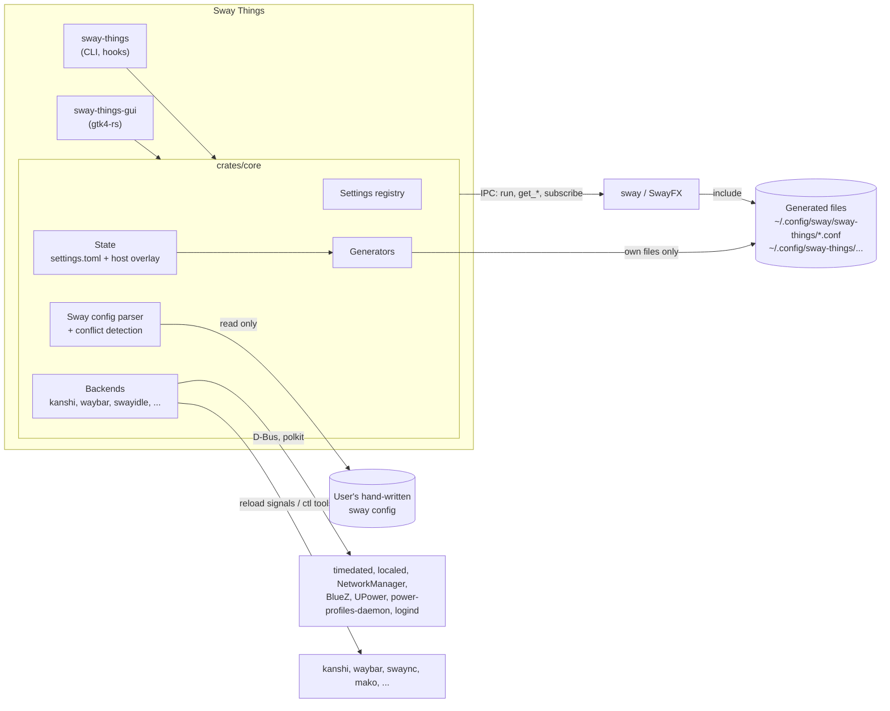

# Architecture

> Status: **design, no code yet.** Facts about sway, SwayFX, kanshi, waybar, mako and swaync were checked on 2026-11-07
> against their man pages, source and releases (sway 1.12, SwayFX 0.6).

## Overview



The core idea: **apply live over IPC, persist to our own state file, generate our own include files, and only ever read
the user's files.**

## Cargo workspace

| Crate | Binary | Depends on GTK | Responsibility |
| --- | --- | --- | --- |
| `crates/core` | – | no | Settings registry, state (load, merge, save, history), generators, sway config parser, conflict detection, IPC client, backends, typed sway command builders |
| `crates/cli` | `sway-things` | no | `get` / `set` / `reset` / `open` / `doctor` / `show-generated` / `export` / `import` / `hook` |
| `crates/gui` | `sway-things-gui` | yes | GTK4 application: shell, sidebar, search, rows built from the registry, custom pages |

All crates share the package metadata and lints of the root `Cargo.toml`: edition 2024, MSRV 1.85, `unsafe_code`
forbidden, clippy pedantic, and no `unwrap`, `expect`, `panic!`, `todo!` or `dbg!` outside tests. The core also denies
`println!` and requires docs for its public API.

The CLI deliberately has no GTK dependency, so hooks that run at login or on hotplug start fast and stay small.
`sway-things` with no arguments, or `sway-things open <page>`, starts or activates the GUI.

## Settings registry

Every setting is **defined once** in `crates/core/src/registry/`. Everything else derives from that definition:

| Derived from the registry | From |
| --- | --- |
| GUI rows (toggle, slider, dropdown, color, entry) | the value type; auto-built for standard settings, on the setting's page |
| Search index | title, subtitle, keywords and synonyms (translatable source strings, also matched in English) |
| CLI keys | the key: `sway-things set input.touchpad.tap true` |
| TOML schema and validation | the key is the path in `settings.toml`; the value type has the range or the choices |
| Defaults and "Reset to default" | the default of the value type |
| Generator output | the render function builds the commands, the mapping names the generated file |
| Conflict detection | the sway directive and block context the setting maps to |
| Version and fork gating | `min_sway(…)`, `swayfx_only(…)` |
| Scope | global / per-host / per-device / per-output (decides the host-overlay default) |
| Apply mode | live, reload, tool-reload, re-login, risky (safety net) |
| Requirements | `requires_tools(&["swayidle"])` → "Requires swayidle" indicator plus install hints |

```rust
// crates/core/src/registry/input.rs
Setting::toggle("input.touchpad.tap", Page::MouseTouchpad, false)
    .title("Tap to click")
    .subtitle("Tap the touchpad instead of pressing it")
    .keywords(&["touchpad", "trackpad"])
    .scope(Scope::PerDevice(InputType::Touchpad))
    .sway(Directive::input("tap"), ConfigFile::Input, |ctx| {
        Ok(vec![ctx.input()?.tap(ctx.bool("input.touchpad.tap")?)])
    })
    .build()
```

- **Value types:** boolean, integer and decimal (each with a range), choice (ids with translatable labels), color, text
  and list of texts. `Setting::check` validates a `Value` against the type. What sway accepts inside a text or a list
  depends on the directive, so the command builders check that when the setting is rendered.
- **Defaults are sway's own:** the default is what sway, libinput or SwayFX does with nothing configured (tap off, no
  gaps, `client.focused` child border `#285577`). A setting that isn't stored therefore shows what is in effect without
  Sway Things, and a reset removes the key from the state. libinput defaults that depend on the device are the common
  ones.
- **Rendering:** `Registry::render(setting, values, device, target)` returns the `SwayCmd`s for one target. The render
  function reads values through a `Context`, which checks each stored value against its setting and falls back to the
  default. Over IPC a setting can need more commands than in the config: `windows.gaps.inner` renders `gaps inner 8` for
  both, and over IPC also `gaps inner all set 8` for the workspaces that are already open.
- **One setting per value:** a directive with several values is several settings. The five colors of `client.focused`
  are `windows.focused.border`, `….background`, `….text`, `….indicator` and `….child_border`. Settings with the same
  directive form a group (`Registry::group`) with one render function that reads all of them, so storing one color
  writes the whole line with the defaults of the others.
- **Per-device settings** have `Scope::PerDevice(<input type>)`. Without a selected device they render for the type
  (`input type:touchpad tap enabled`), with one for that device's identifier.
- **Directive:** each sway setting names its directive, the block it stands in (top level or `input`) and, where one
  name covers independent values, the first argument (`gaps` + `inner`).
- **Apply mode:** live by default. A setting built on a config-only command (`workspace_layout`) must use reload.
- **Preferences of Sway Things itself** (`app.safety_net_timeout`) are settings without a sway mapping.

Tests check the invariants over every entry: keys are unique and valid TOML paths, defaults fit their type, every
setting renders for the config and every live one for IPC, at the limits of its range and for every choice, config-only
commands force the reload mode, and the declared requirements equal those of the built commands (SwayFX settings go to
`90-effects.conf`, nothing else does).

Pages that don't fit the row model are hand-written GTK widgets: the Displays canvas, the bindings editor, the bar
layout editor and the window preview. They still read and write settings through the registry.

## State

```text
$XDG_CONFIG_HOME/sway-things/
├── settings.toml          # shared values: commit to dotfiles
└── settings.d/
    └── <hostname>.toml    # per-machine overrides (optional)

$XDG_STATE_HOME/sway-things/
├── manifest.toml          # every file we generated, with hash, for "changed outside Sway Things" detection
└── history/               # snapshots of the settings files (restore, undo)
    └── 20261110T142355Z/  # both files as they were before a save, named after the UTC time
        ├── settings.toml
        └── settings.d/<hostname>.toml
```

```toml
# settings.toml
version = 1

[input.touchpad]
tap = true

[windows.focused]
child_border = "#3b6e4f"

# settings.d/laptop.toml
version = 1

[device."1267:12377:ELAN1300:00_04F3:3059_Touchpad".input.touchpad]
tap = false
```

- **Sparse:** only settings the user changed are stored. A missing key means _not managed by Sway Things_: the user's
  own config or the sway default applies. A reset removes the key (and tables that are empty afterwards).
- **Keys are TOML paths:** the registry key `input.touchpad.tap` is `tap` in the table `[input.touchpad]`. Colors are
  strings (`#rrggbb`, `#rrggbbaa`), choices are their id, lists are arrays of strings, and a decimal setting also takes
  a whole number.
- **Host overlay:** `settings.d/<hostname>.toml` overrides `settings.toml` key by key. The host name is the kernel's
  (`uname -n`). New values go to the shared file, except those bound to this machine's hardware (a value for one device,
  per-host and per-output settings), which go to the overlay. A changed value stays in the file it is in. The UI shows a
  "this machine only" toggle per setting, which moves the value between the two files. A value written to the shared
  file removes the one in the overlay, which would hide it otherwise.
- **Per-device values** are stored below `device."<identifier>"` (the identifier from `GET_INPUTS`) at the same key as
  the value for all devices of the type. A device without a value of its own uses the value of its type.
- **Hand edits allowed:** a file watcher reports when either file may have changed, and the state reloads the files
  whose content differs from what it last loaded or wrote. So its own saves cause no reload. A reload returns the
  settings whose value in effect changed, for the GUI and the generators. The file on disk wins: a change to that file
  that wasn't saved yet is dropped and is among the changed settings. Whatever doesn't fit the registry is reported with
  file and key, never silently dropped, and the rest still loads: unknown keys, values of the wrong type or out of
  range, entries of `device` that aren't device identifiers, and settings in a device table that can't be set per
  device. The lines stay in the file. A save only changes the lines of the settings that changed; comments, order,
  formatting and unknown keys survive.
- **Schema version:** a top-level `version = 1` key, for migrations. A file without it loads as version 1, and the first
  save adds the line. A file with another version, a syntax error or one that can't be read is reported and left alone:
  nothing in it is in effect, and it is never written. The other file keeps working.
- **Atomic saves:** a changed file is written to a temporary file next to it and renamed over it. If the file is a
  symbolic link (into a dotfiles repository), the link stays and its target is replaced. File access is synchronous
  (`std::fs`): the files are small, and only loading and saving touch the disk.
- **App preferences** (accent source, safety-net timeout, editor command, …) live under `[app]` and are ordinary
  registry entries.
- **Export / import:** `settings.toml` (plus overlays) _is_ the export format.
- **History:** before a save replaces anything, both files as they are on disk go to `history/` as one snapshot, also if
  they were changed outside in the meantime. A snapshot equal to the newest one is skipped, and the newest 50 are kept.
  If the snapshot can't be written, nothing is replaced. Restoring a snapshot loads both files from it, comments and
  unknown keys included (a file that didn't exist then becomes empty), and is written by a normal save, which takes a
  snapshot in turn, so a restore can be undone. A snapshot of a file that can't be loaded can't be restored.
- **Backups:** we never write user files, so we never need to back them up. `history/` covers our own state.

### File watcher

`crates/core/src/watch.rs` watches a set of files for any part of the app: the settings files now, the sway config files
for the include detection later.

- It uses the `notify` crate (inotify on Linux, kqueue on the BSDs) and watches **directories**, not files: the
  directory of each file, or the nearest one above it that exists. That covers a file that is created later, deleted, or
  replaced by a rename (how editors and `git` save), and a directory that appears or goes away. For a file that is a
  symbolic link, the directory of its target is watched too.
- Events about other files in those directories and reads are ignored.
- **Debounce:** a burst of events becomes one report once the watched files have been quiet for 200 ms (after 2 s at the
  latest), so a reader doesn't see a half-written file.
- A report only says that a file _may_ have changed; the reader decides. That keeps self-write suppression out of the
  watcher.
- The watcher debounces on its own thread and hands reports over through a channel. It needs no particular executor:
  await the next report on the glib main loop, or block on it in the CLI.

## Generated files and the file rule

**Rule: Sway Things only writes files it created**. A file we created carries a header and is recorded in
`manifest.toml`. If its hash no longer matches, someone edited it. The app shows a warning and asks before overwriting.

### sway

```text
$XDG_CONFIG_HOME/sway/sway-things/
├── 10-input.conf
├── 20-output.conf         # only when kanshi is not the display backend
├── 30-appearance.conf
├── 40-behavior.conf
├── 50-bindings.conf
├── 60-idle.conf           # swayidle exec line, if the user handed idle over
├── 70-autostart.conf
├── 80-hooks.conf          # bindswitch lid → sway-things hook lid …
└── 90-effects.conf        # SwayFX only; comments instead of directives on vanilla sway
```

```text
# Generated by Sway Things from ~/.config/sway-things/settings.toml. DO NOT EDIT.
# Change settings in the app or with `sway-things set`. Hand edits are overwritten.
input type:touchpad tap enabled
input type:touchpad pointer_accel 0.3
input "1267:12377:ELAN1300:00_04F3:3059_Touchpad" tap disabled
```

`crates/core/src/generate/` makes these files. v0.1 has `10-input.conf`, `30-appearance.conf`, `40-behavior.conf` and
`90-effects.conf`.

- **Content:** `generate` turns the stored settings into file contents without writing anything, which is also what
  "Show generated config" and `sway-things show-generated` display. Below the header, each line is one command exactly
  as the command builders render it for a config file; there are no blocks. The settings of one directive make one line.
  The order is the order of the registry, the lines for input types before those for single devices, so the same state
  gives the same bytes. The registry decides the file of each setting.
- **Unsupported settings:** a stored setting the compositor doesn't support becomes a comment instead of a command, e.g.
  `# effects.corner_radius: requires SwayFX 0.5 or newer`, so the file stays valid and says why a setting has no effect.
  The same happens to a value the command builders reject. The value stays stored. The compositor is the running one,
  asked over IPC; without a session it is the installed one, read from `sway --version`.
- **Validation:** a file whose content changed is staged next to its place, under a hidden name that `*.conf` doesn't
  match, and checked with `sway --validate --config <staged file>` as a main config of its own. sway runs through
  `async-process` with an argument array. Only a valid file replaces the old one, atomically; a symbolic link stays one.
  If sway rejects the file, the old one stays, and each error carries the line and the settings behind it. If sway can't
  be run, nothing is replaced.
- **Manifest:** `manifest.toml` records the SHA-256 hash of each generated file by absolute path (the value `sha256sum`
  prints). Before a file is replaced, its content is compared:

  | The file on disk… | Result |
  | --- | --- |
  | doesn't exist | created, unless it would hold only the header |
  | already holds the new content | left as it is, and recorded |
  | has the recorded hash | replaced |
  | is recorded with another hash, or isn't recorded but starts with the header | reported as changed outside; replaced only after the user agreed |
  | isn't recorded and doesn't start with the header | never written |

  A generated file that isn't recorded came with the dotfiles from another machine, or the manifest was lost; that is
  why the header counts. A manifest that is missing or broken is empty.
- A file that loses its last setting keeps existing with only the header.

The user adds **one line** to their own config, normally as the last line:

```text
include ~/.config/sway/sway-things/*.conf
```

The app never adds this line itself. It shows the line with a copy button and detects it via the parser.

### Other tools

| Tool | Include support | Strategy |
| --- | --- | --- |
| kanshi | yes (`include`, wordexp) | Our file `~/.config/kanshi/sway-things.conf`; the user adds `include` to their kanshi config. With no kanshi config at all, we create `~/.config/kanshi/config` ourselves |
| waybar | `include` exists, but **the first definition wins**, so included files can only add, never override | **Handover:** our complete config + CSS in `~/.config/sway-things/waybar/`; the user starts waybar with `-c`/`-s` (instructions), or we create `~/.config/waybar/config.jsonc` if none exists. "Import as starting point" reads their file into our state |
| swaylock | no | Our config `~/.config/sway-things/swaylock/config`; our generated swayidle line calls `swaylock -C <path>` |
| swayidle | n/a (started via `exec`) | Our generated `60-idle.conf` holds the `exec swayidle …` line. If the user's config already starts swayidle, the page shows "managed externally" plus a handover explanation |
| mako | yes (`include=`, absolute or `~/` path; later definitions win) | Our file `~/.config/mako/sway-things`; the user adds `include=` at the end of their mako config. With no mako config at all, we create it |
| swaync | no, but `-c` / `-s` flags | Handover: our `config.json` + `style.css` in `~/.config/sway-things/swaync/`; the user starts swaync with `-c`/`-s` |
| gammastep / wlsunset | gammastep has a config file; wlsunset uses arguments | Own config file or our generated `exec` line |
| environment | `environment.d` is a directory | Our own file `~/.config/environment.d/50-sway-things.conf` |
| default apps | XDG spec: desktop-specific list | Our own `~/.config/sway-mimeapps.list`, read before `mimeapps.list` under `XDG_CURRENT_DESKTOP=sway`; the user's `mimeapps.list` is never touched |
| GTK look, fonts, dark mode | dconf database | Written via gsettings/GIO (official API, allowed) |
| electron/chromium flags | text files | Create if missing, otherwise handover |
| XDG autostart | directory of `.desktop` files | Our entries are `exec` lines in `70-autostart.conf`. To disable a system entry we create **our own** override `~/.config/autostart/<name>.desktop` with `Hidden=true` (only if no user file of that name exists). The runner (`xdg-desktop-autostart.target` or `dex -a`) is started from our include |

**Handover** means we generate our own complete file and the user switches the tool to it once (an instruction with a
copy button). Alternatively the user deletes or renames their own file, and we create the standard one.

## Data flow

### Changing a normal setting

1. The user flips a toggle (or runs `sway-things set …`).
2. The core builds the sway command with the [**typed builder**](#sway-command-builders) and sends it over IPC
   (`RUN_COMMAND`) → instant effect.
3. The core updates the in-memory state and saves `settings.toml` / the overlay after a debounce (~500 ms).
4. The generators regenerate the affected files:
   - write to a staged file → `sway --validate --config <staged file>` for each staged file → atomic replace. Each file
     is validated as a main config of its own: sway ignores errors in included files (`cmd_include` in sway 1.10 –
     1.12), and `--validate` only reports the main file, so a wrapper config that includes the staged files would always
     pass. This works without a running session (checked with sway 1.12); errors are reported per line, so they can be
     mapped back to settings;
   - update the hash in `manifest.toml`.
5. Conflict detection re-runs for that setting and updates the indicators.

### Risky settings (safety net)

Display mode, disabling an output or input device, keyboard layout changes:

1. Snapshot the current value and apply live.
2. Show the _Keep / Revert_ banner with a 15 s countdown.
3. **Nothing is persisted until the user presses _Keep_.** Revert or timeout re-applies the snapshot over IPC.
4. Lockout protection: the last enabled output and the last enabled keyboard can't be disabled.

**From the CLI**: in an interactive terminal, `sway-things set` applies live, asks `Keep? [y/N]` with the same
countdown, and saves only on `y`. Without a TTY it refuses unless `--yes` is given, so scripts and hooks never hang.

### Apply modes

| Mode | Example | Mechanism |
| --- | --- | --- |
| live | gaps, colors, input options | IPC command + persist |
| reload | settings sway only honors at load | persist + `swaymsg reload` (with confirmation if disruptive) |
| tool reload | kanshi, waybar, swaync | `kanshictl reload`, `SIGUSR2` to waybar, `swaync-client -R`, … |
| re-login | environment.d | persist + "takes effect after re-login" badge |
| risky | see above | live + safety net, persist on _Keep_ |

## Sway command builders

Every sway command, sent over IPC or written into a generated file, is a `SwayCmd` from `crates/core/src/command/`. A
command is a list of typed parts: keywords (static strings from our code, only ASCII letters, digits and `_ . : * + -`),
integers, finite decimals, booleans in the directive's spelling (`enabled`, `yes`, `on`, …), colors (`#rrggbb`,
`#rrggbbaa`), text and criteria. External strings only enter as `SwayText` or as criteria values, never as a raw string.

sway parses IPC commands and config lines differently (`execute_command` and `config_command` in `sway/commands.c`,
helpers in `common/stringop.c`; unchanged from 1.10 to 1.12):

| | IPC (`RUN_COMMAND`) | Config line |
| --- | --- | --- |
| Command separators | `;` and `,` outside quotes | none, one command per line |
| `$variables` | replaced in each argument, after unquoting | replaced in the whole line, before unquoting |
| Quotes | stripped from arguments that start with one (not for `exec`, `mode`) | the same (also not for `bindsym`, `set`, `for_window`, …) |
| Backslashes | kept, but still escape the next quote | unescaped (`\"`, `\\`, `\n`, …) |

So `SwayCmd::render` has two targets:

- **Text over IPC:** quoted with `"`, or with `'` around a run that contains `"`; every `$` is doubled.
  `Dell "U2415" $1` becomes `'Dell "U2415" $$1'`.
- **Text in a config line:** quoted with `"`, inner `"` become `\"`, every `$` is doubled: `"Dell \"U2415\" $$1"`.
- **What text can't contain:** `SwayText` rejects empty text, control characters (they end a config line or change how
  sway splits it) and backslashes. sway's IPC splitter keeps its escape flag across `\'` and then misreads the next
  quote, so a backslash next to a quote can't be represented reliably.
- **Criteria** match exactly. Each value becomes an anchored PCRE2 regex `^…\z` in which every character except ASCII
  letters, digits and `_` is written as `\x{hex}`, so criteria never contain a quote, `$`, `]` or whitespace. Config
  lines double the backslashes, because sway unescapes them.
- **`for_window`:** sway stores the inner command and parses it again, like an IPC command, when a window appears. So
  its text is quoted twice over IPC, and its `$` doubled twice in a config line. The inner command can't contain
  criteria or another `for_window`.
- **Leading criteria:** `SwayCmd::with_criteria` builds `[app_id="…"] opacity 0.8`, which applies a command to open
  windows. It only works over IPC, and sway reports a failure if no window matches. Per-app settings use it for the live
  change and `for_window` for windows that open later.
- **Availability:** some commands work only in config files (`xwayland`, `xkb_numlock`, `workspace_layout`,
  `default_orientation`), so settings built on them apply with a reload instead of live. Others work only over IPC.
  While sway reads the config it defers commands such as `xkb_switch_layout`, `focus` and `workspace <name>` and later
  runs them through the IPC parser, so their builders are runtime-only. Rendering for the wrong target is an error.
- **Minimum version:** a command records the oldest sway that understands it (`SwayCmd::min_sway`, by default sway
  1.10), and for SwayFX directives the oldest SwayFX (`SwayCmd::min_swayfx`, `None` if vanilla sway understands it).
  Rendering doesn't check either; the registry compares them with the running compositor (SwayFX by its base sway
  version for `min_sway`).

On top of `SwayCmd`, typed builders cover the directives of each page, with an enum per set of values and range checks
on numbers taken from sway's and SwayFX's own checks:

- `command::input` builds `input <identifier> …` for every device (`*`), a device type (`type:touchpad`) or one device
  by its `GET_INPUTS` identifier. `drag_lock enabled_sticky` needs sway 1.11, and a sway built against a libinput that
  supports it; otherwise sway reads it as `disabled` without an error.
- `command::window` builds colors (`client.*`; sway ignores `client.background` and `client.placeholder`, so they have
  no builder), borders, gaps, the title bar and `opacity`. `gaps <which> <px>` only changes the default for new
  workspaces, and `gaps <which> all|current set <px>` (runtime-only) only open workspaces, including those with gaps of
  their own from `workspace <name> gaps`; the registry combines them. sway rejects a title bar padding below the border
  thickness and a thickness above the vertical padding, so the order of those two commands matters.
- `command::effects` builds the SwayFX effects with the names and ranges of SwayFX 0.5; `animation_duration_ms` needs
  SwayFX 0.6. `corner_radius` raises the horizontal title bar padding to at least the radius.
- `command::behavior` builds focus, layout, floating, dragging, popup, Xwayland and idle inhibition settings.
  `floating_minimum_size` and `floating_maximum_size` take each dimension as no limit (`-1`), sway's automatic value
  (`0`) or pixels. `inhibit_idle`, like `opacity`, is wrapped in `for_window` or leading criteria for per-app rules.

A port of sway's parsing functions (`command/model.rs`, tests only) checks with property tests that every accepted value
arrives unchanged in both targets. Fixture files generated from the builders (`ci/integration/*.conf` and `*-ipc.txt`)
go to real sway 1.10, sway latest and SwayFX: every generated config file must pass `sway --validate` on its own, every
IPC command must succeed, and the escaping fixtures read every value back. Fixtures marked `# Needs SwayFX.` only run on
SwayFX.

## Reading the current state

- **IPC:** `GET_VERSION`, `GET_INPUTS`, `GET_OUTPUTS`, `GET_SEATS`, `GET_BINDING_MODES`, `GET_BINDING_STATE`,
  `GET_TREE`, `GET_CONFIG`. Event subscriptions for `input`, `output`, `mode`, `workspace`, `shutdown`, `tick`, so
  hotplugged devices and outputs appear immediately. See [IPC client](#ipc-client).
- **`GET_CONFIG` only returns the main config text**, not included files. Many values (all `client.*` colors, `gaps`,
  `font`, bindings) aren't exposed over IPC at all. So the core has its own **read-only parser**.

### IPC client

`crates/core/src/ipc/` talks to the compositor over the socket in `$SWAYSOCK` (`man 7 sway-ipc`).

- **Transport:** the wire format (the magic string `i3-ipc`, payload length, message type, JSON payload) is implemented
  in the core on async-io's Unix socket, so the client runs on any executor. Replies and events are read into the types
  of the `swayipc-types` crate (`ipc::types`). Those types are strict: a value they don't know makes that reply an
  error, not a guess.
- **Without a session:** an unset `SWAYSOCK` ("not in a sway session") and a socket nobody answers on ("sway is not
  running") are different errors, so the CLI and the read-only parts can say which it is and carry on.
- **Compositor detection:** connecting sends `GET_VERSION`. SwayFX is the compositor that sends `sway_original_version`,
  the sway it is based on; its own version is in the version numbers then. A compositor below sway 1.10 or SwayFX 0.5 is
  refused, with what was detected in the error.
- **Commands:** `Client::run` takes a `SwayCmd`, renders it for IPC and sends it in a `RUN_COMMAND` message of its own,
  so the result belongs to that command. A rejected command returns sway's error message and whether it was a parse
  error. A command that needs a newer sway or SwayFX than the running one isn't sent at all: sway doesn't reject every
  value it doesn't know (`drag_lock enabled_sticky` on sway 1.10 means `disabled`).
- **Events:** `Client::subscribe` opens a second connection, so replies and events don't mix, and `Events::next` returns
  them in order. An event that can't be read is an error for that event only, an unknown event type is skipped, and the
  events end when sway closes the connection (after a `shutdown` event, if subscribed).
- **Connecting under load:** sway queues only a few connections before it accepts them, and a connect while that queue
  is full ends unconnected. The client checks the connection and tries again for up to two seconds.
- After an I/O or protocol error a connection is out of step and has to be replaced.

### Sway config parser

- Reads the main config and **resolves includes**: `~`, `$HOME`/environment variables and globs, in sway's order.
- **Never executes anything.** Paths that need command substitution are reported as "unresolved include".
- Handles `set $var` (variables are substituted **when each line is processed**, see `config_command` in sway's
  `commands.c`, so a later `set` doesn't change earlier lines), quoting, line continuations, comments and nested blocks
  (`input {}`, `output {}`, `bar {}`, `mode {}`, `seat {}`).
- Outputs a list of directives with `file:line`, block context and resolved arguments.
- It's best-effort by design (reading, not round-tripping), and it's **fuzzed**.

### Conflict detection

Sway evaluates config top to bottom, and for most settings the last definition wins. The parser knows where our
`include` sits in the user's config.

| User line is… | Effect | Indicator |
| --- | --- | --- |
| before our include | our value wins, the user's line is dead | "Overridden: your config line N is no longer in effect" |
| after our include | the user's value wins, ours is dead | "Your config line N overrides this setting" |
| our include missing | nothing we generate is active | app-wide **read-only** mode with the include instructions |

Per-directive semantics come from the registry: `input` blocks merge per identifier, `exec` accumulates, duplicate
`bindsym` overrides with a warning, `client.*` replaces. Actions on a conflict: **Open in editor at line**
(`$VISUAL`/`$EDITOR`, otherwise the default text editor), **Copy line**, **Let my config win** (removes the setting from
our state).

Bindings defined in the user's config can still be changed from the app: our include comes later, so it can `unbindsym`
and re-bind without touching their file.

## Backends

Each area that has competing tools defines a backend trait:

```rust
trait Backend {
    fn detect(&self) -> Availability;   // installed? running? version? managed externally by file:line?
    fn read(&self) -> Result<Values>;
    fn apply(&self, change: &Change) -> Result<()>;
    fn generate(&self, state: &State) -> Vec<GeneratedFile>;
}
```

| Area | Backends (reference first) |
| --- | --- |
| Display profiles | kanshi; fallback without kanshi: static `output` lines in `20-output.conf` (no profiles); shikane later |
| Bar | waybar, swaybar (`bar {}` block) |
| Idle / lock | swayidle + swaylock |
| Notifications | swaync, mako, dunst (Do Not Disturb first) |
| Night light | gammastep, wlsunset |
| Wallpaper | swaybg via `output * bg`; swww later |
| Launcher | fuzzel, wofi, rofi(-wayland), tofi |
| Screenshots | grim + slurp (grimshot), swappy / satty |
| Clipboard history | cliphist, clipman |
| Auto dark mode | darkman |
| Audio | PulseAudio API via pipewire-pulse (`libpulse-binding` + `libpulse-glib-binding`) |
| Autostart | our `exec` lines + hand-written `exec` (read-only) + XDG autostart with runner detection |
| Bluetooth | BlueZ (D-Bus) |
| Network | NetworkManager (D-Bus) |
| Power | power-profiles-daemon / tuned-ppd, UPower (D-Bus) |
| Brightness | logind `Session.SetBrightness` (no root needed) / brightnessctl; ddcutil for external monitors |
| Time / locale | systemd-timedated, systemd-localed (D-Bus, polkit) |

If an unknown tool or a custom script is in charge (e.g. an `exec ~/.local/bin/my-wallpaper.sh` line), `detect()`
reports **managed externally by file:line**. The page explains this and offers a handover. It never fights the script.

## No daemon: the CLI as a hook

Sway Things keeps nothing running. Behavior that has to happen without the window goes to existing tools, and where glue
is needed, generated config calls the CLI briefly:

```text
# ~/.config/kanshi/sway-things.conf (generated)
profile office {
    output eDP-1 disable
    output "Dell Inc. DELL U2723QE <serial>" mode 3840x2160@60Hz scale 1.5
    exec sway-things hook workspaces --profile office
}

# ~/.config/sway/sway-things/80-hooks.conf (generated)
bindswitch --reload --locked lid:on  exec sway-things hook lid closed
bindswitch --reload --locked lid:off exec sway-things hook lid open
```

Our generated files can also contain the `exec kanshi` / `exec_always kanshictl reload` lines. They're our files, so
that needs no edit of the user's config.

**SwayFX switching edge case:** `90-effects.conf` is only regenerated when the app or CLI runs. On most distros the
`swayfx` and `sway` packages conflict, so switching means reinstalling. After switching to vanilla sway, sway reports
unknown commands (non-fatal) until `sway-things` runs once. `sway-things doctor` detects and fixes this.

## Version and fork gating

- `GET_VERSION` tells sway from SwayFX and gives the version; SwayFX also reports the sway it is based on
  (`sway_original_version`). Minimum: **sway 1.10** (Debian 13 ships 1.10.1) and **SwayFX 0.5**. SwayFX bases: 0.5 →
  sway 1.10.1, 0.5.2/0.5.3 → 1.11, 0.6 → 1.12 (adds animations).
- Registry entries carry `min_sway(...)` / `swayfx_only()`, and every built command its minimum sway version (some
  values need a newer sway than their directive) and, for SwayFX directives, its minimum SwayFX version. Controls the
  running compositor doesn't support show as disabled with a reason, instead of disappearing.
- SwayFX settings go to `90-effects.conf`. While vanilla sway runs, the generator writes a comment per stored effect
  instead of the directive.

## Security model

**Runs as the user. No privileged code, no daemon, no network**.

| Threat | Mitigation |
| --- | --- |
| Command injection via external strings (device names, **SSIDs**, **Bluetooth names**, file names, workspace names, window titles) | Typed sway command builders with escaping and quoting; processes started with argument arrays, never `sh -c` |
| Malicious or broken `settings.toml` from shared dotfiles | Schema validation; `exec`/`bindsym … exec` lines shown verbatim in "Show generated config"; generated sway config validated with `sway --validate` |
| Corrupting the user's config | We never write user files; atomic writes; manifest hashes detect foreign edits to our files |
| Locking the user out (no display, no keyboard) | Safety net with auto-revert; last-output and last-keyboard protection |
| Privilege escalation | Only existing polkit-guarded D-Bus services (timedated, localed, NetworkManager, BlueZ, power-profiles-daemon); root-owned files such as `logind.conf` are **read-only**, with a copyable command |
| Parser exploits | `unsafe_code` forbidden in every crate, fuzzing, never executes during parsing |
| Supply chain | `cargo-deny` (advisories, licenses, sources), lockfile committed, vendored release tarballs, GitHub Actions pinned to commit SHAs with least-privilege permissions, CI tools and dprint plugins pinned with checksums |

## Platform floor

| Component | Minimum | Reason |
| --- | --- | --- |
| sway | 1.10 | Debian 13 (trixie) ships 1.10.1 |
| GTK | 4.18 | Debian 13 ships 4.18.6 |
| Rust (MSRV) | 1.85 | Debian 13 ships 1.85.1. Raised only on demand, at most to trixie-backports (currently 1.96) |

## UI architecture

- Plain **gtk4-rs**. No libadwaita, because it overrides the user's GTK theme. No Relm4, because standard rows are
  generated from the registry anyway, and custom widgets need plain gtk-rs.
- `GtkApplication` with app_id **`io.github.mowi12.SwayThings`**. It handles single instance and D-Bus activation;
  `sway-things open <page>[/<setting>]` activates the running window.
- Generic row widgets (`ToggleRow`, `SliderRow`, `ComboRow`, `ColorRow`, `EntryRow`) are built from registry entries.
  Custom pages are GObject subclasses.
- Our own CSS covers structure only. Colors come from the GTK theme, and the accent comes from the sway `client.focused`
  child border color (live).
- **Concurrency**: one event loop. Futures run on the GTK main context (`glib::spawn_future_local`); I/O uses
  executor-agnostic, async-io based crates (zbus, swayipc-async, async-process); the CLI uses `async_io::block_on`. No
  tokio. `crates/core` must not depend on a specific executor.

## Internationalization

gettext from day one. Source strings (msgids) are American English; en_GB and other languages are translations. Registry
titles, subtitles and keywords are translatable, and search matches both the translated and the English keywords.

## Testing

| Level | What |
| --- | --- |
| Unit | the IPC client against a stand-in for sway (protocol errors, events), registry invariants, state merge (shared + overlay), reload and history, the file watcher against real files, command builders and escaping (property tests against a port of sway's parser) |
| Golden files | every generator: state in → exact file out (`ci/integration/settings/` → `ci/integration/generated/`), for the oldest supported sway and SwayFX |
| Fuzzing | sway config parser (`cargo-fuzz`, scheduled CI) |
| Integration | headless compositor (`WLR_BACKENDS=headless`, `WLR_LIBINPUT_NO_DEVICES=1`) in CI on **sway 1.10, sway latest and SwayFX latest** (containers from Debian 13, Arch Linux and Void Linux in `ci/containers/`; SwayFX renders in software on a virtual DRM node): apply over IPC, read back, validate generated files (incl. `90-effects.conf` on SwayFX); the generators' golden files (each passes `sway --validate` on its own and is included by the sample config) and their write path with the real validator (`crates/core/tests/generate_sway.rs`); the IPC client's tests (`crates/core/tests/ipc.rs`; both built in the containers, skipped by a plain `cargo test`): compositor detection, a command read back, sway's message for a rejected command, version gating, every typed reply, tick and workspace events; fixtures generated from the command builders: each generated config file passes `sway --validate` on its own, every IPC command succeeds, and hostile strings set as bar IDs from a config and as seat names over IPC come back unchanged |
| GUI | smoke tests later; logic stays in `core`, so the GUI stays thin |

## Packaging

- **openSUSE Build Service** builds openSUSE, Fedora, Debian and Ubuntu packages from one project (one `.spec`, one
  `debian/` dir, vendored crates, offline build). **AUR**: release and `-git` packages.
- Shipped: both binaries, `io.github.mowi12.SwayThings.desktop`, AppStream metainfo, icon, man pages (`clap_mangen`),
  shell completions (`clap_complete`), translations.
- No Flatpak. Aim for official distro repositories after 1.0.
- License: `GPL-3.0-or-later`.
