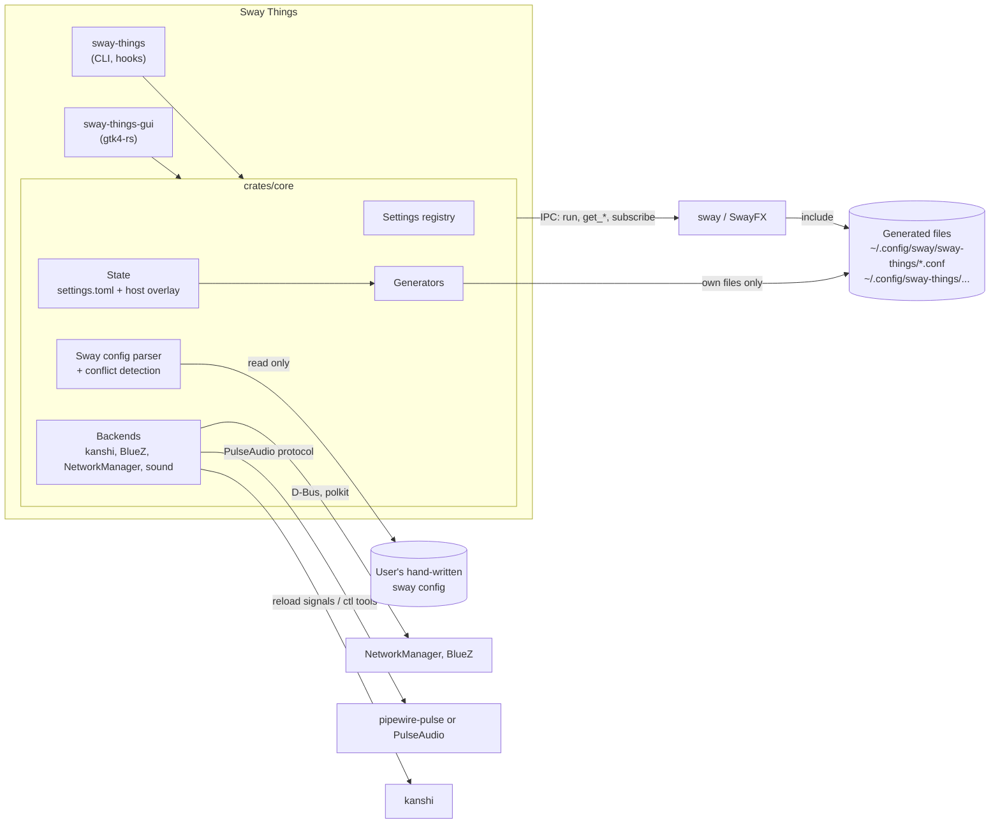

# Architecture

> The facts about sway, SwayFX and the companion tools this design relies on, with their sources, are in the
> [Sway Reference](Sway-Reference.md).

This page is the overview: the crates and their modules, the settings registry, the state files, the generated files,
version gating, the security model and the platform floor. The topics have pages of their own:

| Page | What it covers |
| --- | --- |
| [Applying Settings](Applying-Settings.md) | The data flow of a change, the safety net, apply modes, the typed sway command builders |
| [Reading Sway](Reading-Sway.md) | IPC, input devices, themes, XKB rules, the config parser, include and conflict detection, the editor |
| [Outputs](Outputs.md) | Displays: the output list, display profiles with kanshi, workspace placement, mirroring, arranging |
| [Backends](Backends.md) | BlueZ, NetworkManager, the sound server, GSettings, and the planned backends |
| [Command Line](Command-Line.md) | The commands, the doctor, the hooks instead of a daemon |
| [UI Architecture](UI-Architecture.md) | The GTK app: rows and pages from the registry, the custom pages, the model, translations |
| [Testing](Testing.md) | Which tests exist and where they run |
| [Packaging](Packaging.md) | Tarball, RPM and Debian packages, OBS, the install script, the AUR |
| [Website](Website.md) | sway-things.org, built from the README |

## Overview



The core idea: **apply live over IPC, persist to our own state file, generate our own include files, and only ever read
the user's files.**

The diagram shows what is built. The pages still to come add services and tools the same way (timedated, localed,
UPower, power-profiles-daemon and logind over D-Bus; waybar, swayidle, swaync and mako through their files); their plans
are in the [Feature Catalog](Feature-Catalog.md) and below under _planned_.

## Cargo workspace

| Crate | Binary | Depends on GTK | Responsibility |
| --- | --- | --- | --- |
| `crates/core` | – | no | Settings registry, state (load, merge, save, history), generators, sway config parser, conflict detection, IPC client, backends, typed sway command builders |
| `crates/cli` | `sway-things` | no | `get` / `set` / `reset` / `open` / `doctor` / `show-generated` / `hook` |
| `crates/gui` | `sway-things-gui` | yes | GTK4 application: shell, sidebar, search, rows built from the registry, custom pages |
| `crates/cli-docs` | – (dev only) | no | Writes the man pages and shell completions in `data/` from the clap definitions of the CLI and of the app's one argument |

All crates share the package metadata and lints of the root `Cargo.toml`: edition 2024, MSRV 1.85, `unsafe_code`
forbidden, clippy pedantic, and no `unwrap`, `expect`, `panic!`, `todo!` or `dbg!` outside tests. The core also denies
`println!` and requires docs for its public API.

`crates/cli-docs` is no default member (`default-members` in the root `Cargo.toml`): a plain `cargo build` and the
distro builds compile only the three shipped crates, never `clap_mangen`, `clap_complete` or `roff`. `--workspace`
includes it, so its tests and clippy run with the others.

The CLI deliberately has no GTK dependency, so hooks that run at login or on hotplug start fast and stay small.
`sway-things` with no arguments, or `sway-things open [<link>]`, starts or activates the GUI.

### Module map

Each module starts with a doc comment that says what it is for; this map is where to start reading.

| Crate | Module | What it is |
| --- | --- | --- |
| core | `registry` | every setting, defined once ([Settings registry](#settings-registry)) |
| core | `state`, `ui_state`, `watch`, `atomic` | the settings files, the window state, the file watcher, atomic writes ([State](#state)) |
| core | `generate`, `command`, `version` | the generated sway files, the typed sway commands, version gating ([Generated files](#generated-files-and-the-file-rule), [command builders](Applying-Settings.md#sway-command-builders)) |
| core | `apply`, `view` | changing a setting end to end, and what a row shows ([Applying Settings](Applying-Settings.md)) |
| core | `ipc`, `devices`, `sway_config`, `include`, `conflict`, `xkb`, `cursor`, `look`, `editor` | reading sway and the user's config ([Reading Sway](Reading-Sway.md)) |
| core | `outputs` | displays, kanshi, workspace placement, mirroring ([Outputs](Outputs.md)) |
| core | `bluetooth`, `network`, `sound`, `gsettings`, `delegate`, `dbus` | the services and tools besides sway, and the D-Bus helpers BlueZ and NetworkManager share ([Backends](Backends.md)) |
| core | `doctor`, `system` | the checkup and the system details ([Doctor](Command-Line.md#doctor)) |
| core | `i18n`, `theme` | translations, colors and contrast ([Internationalization](UI-Architecture.md#internationalization)) |
| cli | `lib`, `main`, `change`, `hook`, `displays`, `doctor`, `output`, `prompt`, `spinner` | the arguments and `run`; get, set, reset and show-generated; the hooks; the displays a command names; the doctor's report, `get`'s output, the safety-net prompt, the spinner ([Command Line](Command-Line.md)) |
| gui | `app`, `args`, `window`, `model` | the application, its argument, the main window, the settings behind it ([UI Architecture](UI-Architecture.md)) |
| gui | `widgets` | every building block and custom page, one module each |
| gui | `theme`, `style`, `icons`, `contrast`, `i18n`, `xkb`, `editor` | colors, the style sheet, bundled icons, the runtime contrast check, translations, the XKB names, opening the editor |

## Settings registry

Every setting is **defined once** in `crates/core/src/registry/`. Everything else derives from that definition:

| Derived from the registry | From |
| --- | --- |
| GUI rows (toggle, slider, dropdown, color, entry) | the value type; auto-built for standard settings, on the setting's page |
| Search index | title, subtitle, keywords and synonyms, group title, and the sway directive; pages by title and description |
| CLI keys | the key: `sway-things set input.touchpad.tap true` |
| TOML schema and validation | the key is the path in `settings.toml`; the value type has the range or the choices |
| Defaults and "Reset to default" | the default of the value type |
| Generator output | the render function builds the commands, the mapping names the generated file |
| Conflict detection | the sway directive and block context the setting maps to; the read function gives the value of a user's line |
| Version and fork gating | `min_sway(…)`, `swayfx_only(…)` |
| Dependencies | `depends_on("effects.blur", When::On)`: the row is locked with the reason ("Turn on Blur first") while the other setting's value in effect doesn't meet the condition (on, one of some choices, above a number) |
| Scope | global / per-host / per-device / per-output (decides the host-overlay default); `host_by_default()` sends a per-device value for a whole type to the host overlay too, for values that name something of the machine (an output) |
| Unit | `unit(Unit::Seconds)`: shown after the value where it stands alone, as in a group's summary ("3 s", with a space as in the SI) |
| GSettings copy | `gsettings(INTERFACE, "cursor-theme")`: the value is copied there for the apps that read GSettings; a setting without a sway directive lives there only, see [GSettings](Backends.md#gsettings) |
| Font | `font(Font::Monospace)`: the text is a Pango font description, picked with GTK's font dialog (only monospace families for `Font::Monospace`) |
| Apply mode | live, reload, tool-reload, re-login, risky (safety net) |
| Requirements | `requires_tools(&["swayidle"])` → "Requires swayidle" indicator plus install hints (no setting needs a tool yet) |

```rust
// crates/core/src/registry/input.rs
Setting::toggle("input.touchpad.tap", Page::MouseTouchpad, false)
    .section(msg!("Touchpad"))
    .title(msg!("Tap to click"))
    .subtitle(msg!("Tap the touchpad instead of pressing it. Unless set, the device decides"))
    .keywords(&[msg!("touchpad"), msg!("trackpad")])
    .scope(Scope::PerDevice(InputType::Touchpad))
    .sway(
        Directive::input("tap"),
        ConfigFile::Input,
        |ctx| Ok(vec![ctx.input()?.tap(ctx.bool("input.touchpad.tap")?)]),
        read_switch, // sway's parse_boolean(…, true)
    )
    .build()
```

- **Value types:** boolean, integer and decimal (each with a range), choice (ids with translatable labels), color, text
  and list of texts. `Setting::check` validates a `Value` against the type. What sway accepts inside a text or a list
  depends on the directive, so the command builders check that when the setting is rendered. A list can have empty
  items, so that it lines up with another list (`["", "nodeadkeys"]`: no variant for the first layout).
- **Defaults are sway's own:** the default is what sway, libinput or SwayFX does with nothing configured (tap off, no
  gaps, `client.focused` child border `#285577`). A setting that isn't stored therefore shows what is in effect without
  Sway Things, and a reset removes the key from the state. libinput defaults that depend on the device are the common
  ones.
- **Rendering:** `Registry::render(setting, values, device, target)` returns the `SwayCmd`s for one target. The render
  function reads values through a `Context`, which checks each stored value against its setting and falls back to the
  default. Over IPC a setting can need more commands than in the config: `windows.gaps.inner` renders `gaps inner 8` for
  both, and over IPC also `gaps inner all set 8` for the workspaces that are already open.
- **Dependencies:** a setting that only matters while another one is set (blur passes while blur is on, a border width
  for the styles with a border) names it with `depends_on`. `SettingView` locks the row with `Locked::Needs` and the
  reason while the value in effect of the other setting (stored, from the user's config or the default) doesn't meet the
  condition. Stored values are still generated. The other setting is on the same page and comes earlier.
- **Order in the generated file** is the order of the registry. sway checks some directives against values already in
  effect: `titlebar_border_thickness` comes before `titlebar_padding`, so any thickness up to sway's default vertical
  padding of 4 fits before the padding changes, and the padding then fits the thickness.
- **One setting per value:** a directive with several values is several settings. The five colors of `client.focused`
  are `windows.focused.border`, `….background`, `….text`, `….indicator` and `….child_border`. Settings with the same
  directive form a group (`Registry::group`) with one render function that reads all of them, so storing one color
  writes the whole line with the defaults of the others. An `input` option is a directive of its own per input type
  (`events` of keyboards and of touchpads), so a group also shares the scope. Each member of a group names the same
  `SettingGroup` (`.group("windows.focused", "Focused window")`): an id, unique and no setting's key, and a translatable
  title the app shows the group's row with. A setting alone in its group names none.
- **Per-device settings** have `Scope::PerDevice(<input type>)`. Without a selected device they render for the type
  (`input type:touchpad tap enabled`), with one for that device's identifier.
- **One at a time:** a setting built with `.one_at_a_time()` is only stored for one device or output, never for all of
  them (`StateError::OneAtATime`; such a value outside a device table is a problem of the file): an output's position
  for every output would stack them all on one spot, and a mode, a rotation or switching off for every output couldn't
  be tried and reverted safely. The Displays page offers only the scale for _All displays_.
- **Per-output settings** (the Displays and Wallpaper pages) have `Scope::PerOutput`. Without a selected output they
  render for every output (`output * scale 2`), with one for that output's identifier (make, model and serial; see
  [Outputs](Outputs.md)). `Setting::check_device` says whether a string can select a device or an output for a setting.
  Where sway decides by itself while nothing is set (the preferred mode, the position next to the other outputs, a scale
  for the pixel density), the default means "nothing set": an empty mode or position (`""`) and a scale that isn't
  stored render no command. sway has no command that hands such a value back to its own choice, so a reset of one takes
  effect after a reload of sway, live and through the safety net alike.
- **Settings that set a display up** (mode, position, scale, rotation, on or off) are built with `.sets_up_display()`,
  which also gives them `Scope::PerOutput`. Only these are left to kanshi while it runs, remembered per combination of
  displays and bring the display guard; the wallpaper is per output too, but none of that applies to it.
- **`output` lines with several settings:** sway reads `output DP-4 mode 2560x1440 pos 0 0 scale 1` subcommand by
  subcommand, each taking the words it needs (`registry/output_line.rs`, after `cmd_output` and its handlers in sway's
  `commands/output/`). `Setting::read` splits such a line and reads its own subcommand; aliases count as the registry's
  name (`res` and `resolution` as `mode`, `position` as `pos`, `disable` and `toggle` as `enable`). A line with an
  unknown subcommand or a missing argument sets nothing, as in sway.
- **Lists that line up:** layouts and variants are two settings, each with its own directive
  (`input.keyboard.xkb_layout = ["us", "de"]`, `input.keyboard.xkb_variant = ["", "nodeadkeys"]` → `xkb_layout "us,de"`,
  `xkb_variant ",nodeadkeys"`). The variants render with the number of layouts in effect: a shorter list is padded with
  empty variants, a longer one is a `RenderError::TooManyVariants`. Reading a user's `xkb_variant` splits on commas and
  keeps empty variants, except those at the end, which the padding adds again.
- **Empty means sway's default:** where XKB takes an empty value as none or as its default, the setting's default is
  empty and renders as `""`: no variants (`xkb_variant ""`), no XKB options (`xkb_options ""`, which also overrides
  `XKB_DEFAULT_OPTIONS`) and the default model (`xkb_model ""`, pc105). Like every setting, they are only written when
  stored.
- **Directive:** each sway setting names its directive, the block it stands in (top level or `input`) and, where one
  name covers independent values, the leading arguments (`gaps` + `inner`, `for_window` + `[all]` + `inhibit_idle`). A
  value can render no line at all: idle inhibition that is off leaves the user's own `inhibit_idle` rules alone.
- **Reading:** each sway setting also has a read function, the reverse of rendering: `Setting::read` takes a directive
  of the user's config and returns the value sway reads from it. The helpers follow sway's own parsing: its words for
  true (`parse_boolean`, everything else is false), `strtol` and `atoi` for numbers, `parse_color` with or without `#`
  (an opaque alpha is the same color as none), the defaults of a `client.*` line for the colors it leaves out (the
  indicator of the class, the background as child border). A line sway refuses (`ReadError::Rejected`) is told apart
  from a value sway takes but the setting can't hold (`ReadError::Unsupported`, e.g. out of its range). Every setting of
  a group reads its own value from the same line.
- **Apply mode:** live by default. A setting built on a config-only command (`workspace_layout`, `xkb_numlock`,
  `xkb_capslock`) must use reload. Settings that change what the keys produce (layouts, variants, XKB options) are
  risky. Instead of the safety net, a range keeps other settings usable: the repeat rate is at least 1 per second (sway
  turns repeating off at 0) and the repeat delay at least 100 ms (below that every key repeats almost at once).
- **Preferences of Sway Things itself** (`app.safety_net_timeout`, `app.accent_source`, `app.editor_command`,
  `app.show_directives`, `app.remember_collapsed_sections`, `app.sound_above_100`, `app.bluetooth_search`,
  `app.wifi_search`, `app.wallpaper_folder`) are settings without a sway mapping, like the settings of a wallpaper
  collection. A text setting can have its own check beyond the type (`SettingBuilder::check_text`; the editor command
  must split into words) and a hint for its empty field (`SettingBuilder::placeholder`).
- **Search:** `SearchIndex::new(registry, translate)` collects the texts of every page and setting once, in English and
  translated, in lowercase. Synonyms are keywords like any other (`dpi`, `sensitivity` → _Pointer speed_), and so is the
  title of a setting's group (_Focused window_ for its _Title bar border_). `search` needs every word of the query in
  one of the texts, case-insensitively. Hits where every word starts a word come before hits inside words (`tap` in _Tap
  to click_ before _metaphor_), then they rank by the weakest field a word was found in: title, keyword, subtitle (a
  page's description), directive. Each hit is a `Link` to its page and setting, so opening one works like a deep link.
  Pages are found by name whether they have settings or not.
- **Pages:** `Page::ALL` lists every page of the app in sidebar order, each with its id, sidebar group (`Group`), title
  and one-line description. The id is what deep links and the CLI use (`sway-things open mouse-touchpad`). Every setting
  names its page, and the registry lists the settings in page order.
- **Deep links:** `Link::parse` reads a link as a page id (`keyboard`) or the key of a setting
  (`input.keyboard.repeat_rate`), which opens the setting's page at its row; keys contain dots, page ids don't. An
  unknown page is a `LinkError` that lists the page ids, an unknown key one that lists the keys it comes closest to
  (those that start with the longest known part, `input.keyboard.`). The CLI and the app read links the same way.
- **Sections:** every setting names the section of its page it is shown in (`.section("Touchpad")`, translatable), and
  the settings of a section are next to each other.
- **Sliders:** a number setting can give a slider range and step narrower than what sway accepts
  (`.slider(100.0, 2000.0, 10.0)` for a repeat delay sway takes up to 65535 ms). Without one, the slider covers the
  whole range, in steps of 1 for whole numbers and a hundredth of the range for decimals.
- **Config line:** `Registry::config_line(setting, values, device)` is the line of the generated file for a value, as
  the app shows it under the title: an `input` option without its `input <selector>` (`pointer_accel 0.3`).
- **What a row shows** (`crates/core/src/view.rs`): `SettingView::of(setting, device, state, status, compositor, known)`
  gives the value in effect and its source: the stored value (for a device without one of its own, its type's), else
  what the user's config sets (the last line that decides it, with file and line), else for an output what it runs with
  now (`known` has the outputs), else sway's default. With one value of a group stored, Sway Things writes the whole
  line, so the others show its defaults. It also has the config line and why the setting is locked: no include line, or
  a compositor that doesn't support it.

Tests check the invariants over every entry: keys are unique and valid TOML paths, defaults fit their type, every
setting renders for the config and every live one for IPC, at the limits of its range and for every choice, config-only
commands force the reload mode, and the declared requirements equal those of the commands built for the default (a value
may need more, like sticky drag lock on sway 1.11; SwayFX settings go to `90-effects.conf`, nothing else does). The
settings that name a `SettingGroup` are exactly those that render one directive together, next to each other on one page
and in one section.

The registry is the bottom layer of the core: it imports none of the modules that use it (outputs, GSettings, the
editor, cursors). Keys and defaults other modules share with it are defined in the registry and re-exported there:
`outputs::MODE` is `registry::output::MODE`, `gsettings::INTERFACE` is `registry::look::INTERFACE`, `editor::KEY` is
`registry::app::EDITOR_COMMAND`, and the editor command's word splitting is `registry::words`.

Pages that don't fit the row model are hand-written GTK widgets: the Displays canvas and the pages of the live services
(Bluetooth, Network, Sound); the bindings editor and the bar layout editor are planned. They still read and write
settings through the registry.

## State

Sway Things keeps its own settings files as the source of truth instead of reading values back from sway: IPC can't
report many values (client colors, gaps, the font) and can't tell a value the user chose from a sway default, and
rewriting sway syntax in place is fragile. The CLI and the history build on the same files, and so will export and
import (planned). The per-machine overlay exists because dotfiles are shared between machines, and some values differ
per machine.

```text
$XDG_CONFIG_HOME/sway-things/
├── settings.toml          # shared values: commit to dotfiles
├── displays.toml          # display profiles: arrangements per combination of displays, see Outputs
└── settings.d/
    └── <hostname>.toml    # per-machine overrides (optional)

$XDG_STATE_HOME/sway-things/
├── manifest.toml          # every file we generated, with hash, for "changed outside Sway Things" detection
├── ui.toml                # which sections of which pages are collapsed (app state, not a setting)
├── wallpaper/             # links to the current picture of each output's collection: all, output-<id>
└── history/               # snapshots of the settings files (restore, undo)
    └── 20261110T142355Z/  # both files as they were before a save, named after the UTC time
        ├── settings.toml
        └── settings.d/<hostname>.toml
```

```toml
# settings.toml
version = 1

[input.touchpad]
tap = true

[windows.focused]
child_border = "#3b6e4f"

# settings.d/laptop.toml
version = 1

[device."1267:12377:ELAN1300:00_04F3:3059_Touchpad".input.touchpad]
tap = false

[display."Dell Inc. DELL U2723QE ABC123".output]
scale = 1.5
position = "1920,0"
```

- **Sparse:** only settings the user changed are stored. A missing key means _not managed by Sway Things_: the user's
  own config or the sway default applies. A reset removes the key (and tables that are empty afterwards).
- **Keys are TOML paths:** the registry key `input.touchpad.tap` is `tap` in the table `[input.touchpad]`. Colors are
  strings (`#rrggbb`, `#rrggbbaa`), choices are their id, lists are arrays of strings, and a decimal setting also takes
  a whole number.
- **Host overlay:** `settings.d/<hostname>.toml` overrides `settings.toml` key by key. The host name is the kernel's
  (`uname -n`). New values go to the shared file, except those bound to this machine's hardware (a value for one device
  or one output, per-host settings), which go to the overlay. A changed value stays in the file it is in. The UI shows a
  "this machine only" toggle per setting, which moves the value between the two files. A value written to the shared
  file removes the one in the overlay, which would hide it otherwise.
- **Per-device values** are stored below `device."<identifier>"` (the identifier from `GET_INPUTS`) at the same key as
  the value for all devices of the type. A device without a value of its own uses the value of its type.
- **Per-output values** are stored below `display."<identifier>"` at the same key as the value for every output
  (`[output] scale = 2`, which is why the table isn't called `output`). An output without a value of its own uses the
  value for every output.
- **Per-collection values** (`Scope::PerCollection`) are stored below `collection."<name>"`, without the `collection.`
  their keys start with: `collection.order` of the collection _Nature_ is `order` in `[collection.Nature]`. A collection
  name has 1 to 64 characters, no control characters and no spaces at either end. There is no value for every
  collection; the values go to the shared file.
- **Hand edits allowed:** a file watcher reports when either file may have changed, and the state reloads the files
  whose content differs from what it last loaded or wrote. So its own saves cause no reload. A reload returns the
  settings whose value in effect changed, for the GUI and the generators. The file on disk wins: a change to that file
  that wasn't saved yet is dropped and is among the changed settings. Whatever doesn't fit the registry is reported with
  file and key, never silently dropped, and the rest still loads: unknown keys, values of the wrong type or out of
  range, entries of `device` that aren't device identifiers, of `display` that can't name an output or of `collection`
  that aren't collection names, and settings in such a table that can't be set for it. The lines stay in the file. A
  save only changes the lines of the settings that changed; comments, order, formatting and unknown keys survive.
- **Schema version:** a top-level `version = 1` key, for migrations. A file without it loads as version 1, and the first
  save adds the line. A file with another version, a syntax error or one that can't be read is reported and left alone:
  nothing in it is in effect, and it is never written. The other file keeps working.
- **Saving needs the include line:** `State::save` takes the write permission that only an active
  [include status](Reading-Sway.md#include-detection) hands out. Loading, changing values in memory and reading need
  none.
- **Atomic saves:** a changed file is written to a temporary file next to it and renamed over it (`atomic`). If the file
  is a symbolic link (into a dotfiles repository), the link stays and its target is replaced. The temporary name carries
  the process id; a file of that name left by a crashed process is removed first, so it never blocks a save. File access
  is synchronous (`std::fs`): the files are small, and only loading and saving touch the disk.
- **App preferences** (accent source, safety-net timeout, editor command, …) live under `[app]` and are ordinary
  registry entries.
- **Export / import (planned):** `settings.toml` (plus overlays) _is_ the export format.
- **History:** before a save replaces anything, both files as they are on disk go to `history/` as one snapshot, also if
  they were changed outside in the meantime. A snapshot equal to the newest one is skipped, and the newest 50 are kept.
  If the snapshot can't be written, nothing is replaced. Restoring a snapshot loads both files from it, comments and
  unknown keys included (a file that didn't exist then becomes empty), and is written by a normal save, which takes a
  snapshot in turn, so a restore can be undone. A snapshot of a file that can't be loaded can't be restored. Restoring
  is built in the core (`State::restore`); no page or command offers it yet.
- **Backups:** we never write user files, so we never need to back them up. `history/` covers our own state.
- **Window state:** `ui.toml` lists the collapsed sections by page id and section id (the English section title in
  lowercase words joined by dashes, `focused-tab-title`), version 1. It is UI state, not a setting, so it lives per
  machine next to the history and never in `settings.toml` or the host overlay, and dotfiles diffs stay clean. The app
  writes it atomically on each collapse or expand while `app.remember_collapsed_sections` is on, also while read-only; a
  missing or broken file means every section is expanded, and unknown page or section ids are ignored
  (`ui_state::UiState`).

### File watcher

`crates/core/src/watch.rs` watches a set of files for any part of the app: the settings files, and the sway config files
for the [include detection](Reading-Sway.md#include-detection).

- It uses the `notify` crate (inotify on Linux, kqueue on the BSDs) and watches **directories**, not files: the
  directory of each file, or the nearest one above it that exists. That covers a file that is created later, deleted, or
  replaced by a rename (how editors and `git` save), and a directory that appears or goes away. For a file that is a
  symbolic link, the directory of its target is watched too.
- Events about other files in those directories and reads are ignored.
- It can also watch a **directory** for the files directly in it (created, changed, renamed, deleted), which is how a
  glob such as `include config.d/*` is followed.
- **Debounce:** a burst of events becomes one report once the watched files have been quiet for 200 ms (after 2 s at the
  latest), so a reader doesn't see a half-written file.
- A report only says that a file _may_ have changed; the reader decides. That keeps self-write suppression out of the
  watcher.
- The watcher debounces on its own thread and hands reports over through a channel. It needs no particular executor:
  await the next report on the glib main loop, or block on it in the CLI.

## Generated files and the file rule

**Rule: Sway Things only writes files it created**. A file we created carries a header and is recorded in
`manifest.toml`. If its hash no longer matches, someone edited it. The app shows a warning and asks before overwriting.
The rule is the same for sway and every companion tool, so the promise stays one rule that is easy to explain.

The user includes our files at the end of their config, so that a change made in the app survives a reload; their own
lines that come after the include and set the same thing win, and conflict detection shows them.

### sway

```text
$XDG_CONFIG_HOME/sway/sway-things/
├── 10-input.conf
├── 20-output.conf         # the wallpapers; the displays' lines only while kanshi doesn't run
├── 30-appearance.conf
├── 40-behavior.conf
├── 50-bindings.conf       # planned
├── 60-idle.conf           # planned: swayidle exec line, if the user handed idle over
├── 70-autostart.conf      # planned
├── 80-hooks.conf          # sway-things hook gsettings; later: bindswitch lid → sway-things hook lid …
└── 90-effects.conf        # SwayFX only; comments instead of directives on vanilla sway
```

```text
# Generated by Sway Things from ~/.config/sway-things/settings.toml. DO NOT EDIT.
# Change settings in the app or with `sway-things set`. Hand edits are overwritten.
input type:touchpad tap enabled
input type:touchpad pointer_accel 0.3
input "1267:12377:ELAN1300:00_04F3:3059_Touchpad" tap disabled
```

`crates/core/src/generate/` makes these files. So far there are `10-input.conf`, `20-output.conf`, `30-appearance.conf`,
`40-behavior.conf`, `80-hooks.conf` and `90-effects.conf`. `seat` options (`seat * xcursor_theme`) go to
`10-input.conf`; `80-hooks.conf` holds the lines that run hooks of the command line (`20-output.conf` ends with the one
that keeps a display on), see [No daemon](Command-Line.md#no-daemon-the-cli-as-a-hook).

- **Content:** `generate` turns the stored settings into file contents without writing anything, which is also what
  _Generated config_ and `sway-things show-generated` display; `on_disk` reads the files as they are, with their
  ownership (absent, current, ours, edited outside, foreign), for the window to mark. Below the header, each line is one
  command exactly as the command builders render it for a config file; there are no blocks. The settings of one
  directive make one line. The order is the order of the registry, the lines for input types before those for single
  devices, so the same state gives the same bytes. The registry decides the file of each setting.
- **Unsupported settings:** a stored setting the compositor doesn't support becomes a comment instead of a command, e.g.
  `# effects.corner_radius: requires SwayFX 0.5 or newer`, so the file stays valid and says why a setting has no effect.
  The same happens to a value the command builders reject. The value stays stored. The compositor is the running one,
  asked over IPC; without a session it is the installed one, read from `sway --version`.
- **Validation:** a file whose content changed is staged next to its place, under a hidden name that `*.conf` doesn't
  match, and checked with `sway --validate --config <staged file>` as a main config of its own. sway runs through
  `async-process` with an argument array. Only a valid file replaces the old one: the staged file itself is renamed into
  place, so exactly the bytes sway checked land there, and only then is the manifest updated; a symbolic link stays one.
  If sway rejects the file, the old one stays, and each error carries the line and the settings behind it. If sway can't
  be run, nothing is replaced.
- **Manifest:** `manifest.toml` records the SHA-256 hash of each generated file by absolute path (the value `sha256sum`
  prints). Before a file is replaced, its content is compared:

  | The file on disk… | Result |
  | --- | --- |
  | doesn't exist | created, unless it would hold only the header |
  | already holds the new content | left as it is, and recorded |
  | has the recorded hash | replaced |
  | is recorded with another hash, or isn't recorded but starts with the header | reported as changed outside; replaced only after the user agreed |
  | isn't recorded and doesn't start with the header | never written |

  A generated file that isn't recorded came with the dotfiles from another machine, or the manifest was lost; that is
  why the header counts. A manifest that is missing or broken is empty.
- A file that loses its last setting keeps existing with only the header.
- **Writing needs the include line:** like saving the state, `generate::write` takes the write permission of an active
  [include status](Reading-Sway.md#include-detection). `generate` needs none, so the preview works while read-only.

The user adds **one line** to their own config, normally as the last line:

```text
include ~/.config/sway/sway-things/*.conf
```

The app never adds this line itself. It shows the line with a copy button and detects it via the parser, see
[Include detection](Reading-Sway.md#include-detection).

### Other tools

Only kanshi is built, see [Outputs](Outputs.md); the other rows are the plan for the pages still to come.

| Tool | Include support | Strategy |
| --- | --- | --- |
| kanshi | yes (`include`, wordexp) | Our file `~/.config/kanshi/sway-things.conf`; the user adds `include` to their kanshi config. With no kanshi config at all, we create `~/.config/kanshi/config` ourselves |
| waybar | `include` exists, but **the first definition wins**, so included files can only add, never override | **Handover:** our complete config + CSS in `~/.config/sway-things/waybar/`; the user starts waybar with `-c`/`-s` (instructions), or we create `~/.config/waybar/config.jsonc` if none exists. "Import as starting point" reads their file into our state |
| swaylock | no | Our config `~/.config/sway-things/swaylock/config`; our generated swayidle line calls `swaylock -C <path>` |
| swayidle | n/a (started via `exec`) | Our generated `60-idle.conf` holds the `exec swayidle …` line. If the user's config already starts swayidle, the page shows "managed externally" plus a handover explanation |
| mako | yes (`include=`, absolute or `~/` path; later definitions win) | Our file `~/.config/mako/sway-things`; the user adds `include=` at the end of their mako config. With no mako config at all, we create it |
| swaync | no, but `-c` / `-s` flags | Handover: our `config.json` + `style.css` in `~/.config/sway-things/swaync/`; the user starts swaync with `-c`/`-s` |
| gammastep / wlsunset | gammastep has a config file; wlsunset uses arguments | Own config file or our generated `exec` line |
| environment | `environment.d` is a directory | Our own file `~/.config/environment.d/50-sway-things.conf` |
| default apps | XDG spec: desktop-specific list | Our own `~/.config/sway-mimeapps.list`, read before `mimeapps.list` under `XDG_CURRENT_DESKTOP=sway`; the user's `mimeapps.list` is never touched |
| GTK look, fonts, dark mode, cursor | dconf database | Written via GIO (official API, allowed); see [GSettings](Backends.md#gsettings) |
| electron/chromium flags | text files | Create if missing, otherwise handover |
| XDG autostart | directory of `.desktop` files | Our entries are `exec` lines in `70-autostart.conf`. To disable a system entry we create **our own** override `~/.config/autostart/<name>.desktop` with `Hidden=true` (only if no user file of that name exists). The runner (`xdg-desktop-autostart.target` or `dex -a`) is started from our include |

**Handover** means we generate our own complete file and the user switches the tool to it once (an instruction with a
copy button). Alternatively the user deletes or renames their own file, and we create the standard one.

## Version and fork gating

- `GET_VERSION` tells sway from SwayFX and gives the version; SwayFX also reports the sway it is based on
  (`sway_original_version`). Minimum: **sway 1.10** (Debian 13 ships 1.10.1) and **SwayFX 0.5**. SwayFX bases: 0.5 →
  sway 1.10.1, 0.5.2/0.5.3 → 1.11, 0.6 → 1.12 (adds animations).
- Registry entries carry `min_sway(...)` / `swayfx_only()`, and every built command its minimum sway version (some
  values need a newer sway than their directive) and, for SwayFX directives, its minimum SwayFX version. Controls the
  running compositor doesn't support show as disabled with a reason, instead of disappearing.
- SwayFX settings go to `90-effects.conf`. While vanilla sway runs, the generator writes a comment per stored effect
  instead of the directive, so a vanilla sway config stays valid (sway rejects SwayFX directives).

## Security model

**Runs as the user. No privileged code, no daemon, no network**. These rules are the app's: the CLI, the GUI and what
they generate. The install script (`scripts/install-from-obs.sh`, served at sway-things.org/install) is distribution
tooling outside them, as a package manager is: run once by the user, it becomes root (directly, through `sudo` or
`doas`) to add the repository and install the package, and it downloads from the openSUSE Build Service. Its own row in
the table says what protects it.

| Threat | Mitigation |
| --- | --- |
| Command injection via external strings (device names, **SSIDs**, **Bluetooth names**, file names, workspace names, window titles) | Typed sway command builders with escaping and quoting; processes started with argument arrays, never `sh -c`; the editor command is split into words without a shell and expands nothing |
| Malicious or broken `settings.toml` from shared dotfiles | Schema validation; `exec`/`bindsym … exec` lines shown verbatim in _Generated config_; generated sway config validated with `sway --validate` |
| Corrupting the user's config | We never write user files; atomic writes; manifest hashes detect foreign edits to our files |
| Locking the user out (no display, no keyboard) | Safety net with auto-revert; last-output and last-keyboard protection |
| Privilege escalation | Only existing polkit-guarded D-Bus services (timedated, localed, NetworkManager, BlueZ, power-profiles-daemon); root-owned files such as `logind.conf` are **read-only**, with a copyable command |
| Parser exploits | `unsafe_code` forbidden in every crate, limits on what a config expands to, files read no further than 8 MiB and only if they are regular files, fuzzing (on every change and daily), never executes during parsing |
| A tampered install script or repository (the install script runs as root and downloads) | Served from the repository's own site over HTTPS; downloads over HTTPS only, with no fallback; the signing key's fingerprint is pinned in the script and checked before the key is trusted, computed without gpg from the key packet; a key file with a second key or a subkey is refused, since rpm and apt would trust every key in it; the package manager then checks every package against that key; everything runs from the script's last line, so a download cut off halfway runs nothing; `--dry-run` prints every command first |
| Supply chain | `cargo-deny` (advisories, licenses, sources), lockfile committed, vendored release tarballs, GitHub Actions pinned to commit SHAs with least-privilege permissions, CI tools and dprint plugins pinned with checksums |

## Platform floor

| Component | Minimum | Reason |
| --- | --- | --- |
| sway | 1.10 | Debian 13 (trixie) ships 1.10.1 |
| GTK | 4.18 | Debian 13 ships 4.18.6 |
| gtk4-layer-shell | 1.0 | Debian 13 ships 1.0.4; the crate (0.7, for gtk4 0.10) is used without the features of 1.3 |
| Rust (MSRV) | 1.85 | Debian 13 ships 1.85.1. Raised only on demand, at most to trixie-backports (currently 1.96) |
